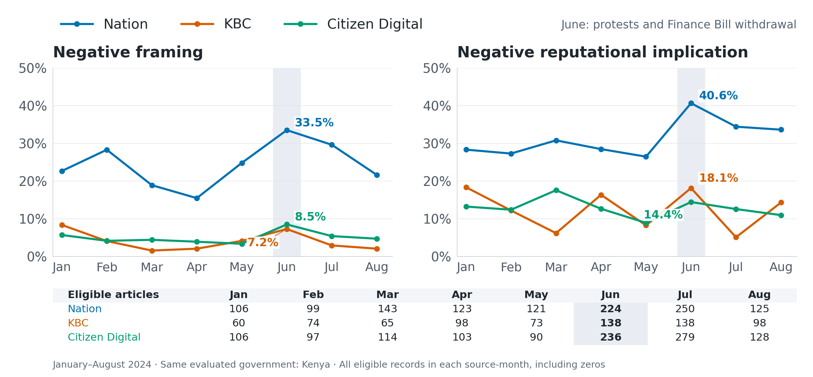

## The Puzzle {.smaller}

- Polarization is understood as a common feature of politics across the world
- Big Question: Is it a cause or a consequence of democratic backsliding?
  * Theory runs both ways: polarized voters tolerate incumbents' violations [@svolik_2019; @graham_svolik_2020]; incumbents deepen polarization strategically [@somer_etal_2021]
- Most research is on the US (+ a few others)
- Cross-national evidence linking polarization to backsliding is largely correlational and slow-moving [cites]
- Can we measure polarization systematically across countries and over time to answer the big question? 

::: notes
- general dependence on policy scales derived from legislative voting behavior or public opinion data. legislative policy scales only available for a handful of countries.
- Orhan (2022): affective polarization across 53 countries correlates with backsliding; ideological polarization does not. Cross-national, survey based.
:::


## Existing work on the US {.smaller .literature-detail}

- **Substantive debate:** is mass polarization real or confined to elites? [@fiorina_abrams_2008; @abramowitz_saunders_2008]. The field has since shifted from ideology to affect [@iyengar_etal_2019]
- **Measures of polarization:**
  * Legislative: distance between parties on roll-call ideal points [@poole_rosenthal_1985; @mccarty_etal_2006]
  * Public opinion: issue-position distributions; party feeling thermometers [cites]
  * Speech: partisanship of congressional speech [@gentzkow_etal_2019]
  * Media:....Gentzow, Shapiro, Taddy
- **Key findings:**
  * Roll-call polarization has risen steadily since the 1970s [@mccarty_etal_2006]
  * Affective polarization has risen; mass ideological polarization remains contested [@iyengar_etal_2019]
  * Media: partisan news shifts votes and can raise polarization [@MartinYurukoglu2017]; effects concentrate among viewers who are already partisan [@levendusky_2013; @prior2013media]

::: notes
- Citation completion: add the intended Matt reference and the remaining media literature.
- Comparability of legislative polarization measures over time requires scrutiny
- measured as the distance between the two parties on an ideology scale estimated from roll-call votes.
- NOMINATE, DW-NOMINATE, etc.: members who serve in many Congresses link the scale across years. Does anyone think they (and the agenda and what makes it to a floor vote) are consistent over time?
:::


## Existing comparative work {.smaller}

- **Party-system ideological polarization:** spread of party positions from voter or expert placements [@dalton_2008, UNC expert project]
- **Mass affective polarization:** CSES like–dislike scores [@reiljan_2020; @wagner2021affective]; V-Dem "political polarization", near-global [@vdem]
  * Twelve OECD countries over four decades: US shows the largest increase [@boxell_etal_2024]
- **Relational measures:** mass partisan polarization over parties [cite]
- **Common limits:**
  * Election-year or annual frequency
  * Survey coverage thin outside democracies
  * Party-based scales presume stable, programmatic party systems

::: notes
- Expert codings of polarization may be informed by the same events that define backsliding. This argues for a measure built from a different data source.
:::


## A common political reference {.smaller}

- Polarization requires a political dimension and an object of comparison
- Party and ideological scales vary across countries and over time
- We use the **national incumbent government** as a common reference
  * Support and opposition can organize conflict in fluid party systems and autocracies
  * This connects to accounts of “pernicious” polarization [@somer_etal_2021]
- News can reveal conflict around the incumbent at a finer time scale
- The measurement question is what an article's positive or negative content refers to

::: notes
The national incumbent is a proposed common political reference. Its relationship to societal polarization requires validation. Incumbent identity can change within a country series.
:::


## What does “negative” mean? {.sentiment-questions-slide}

```{=html}
<ol class="sentiment-questions">
  <li><span class="question-mark question-out" aria-label="Outside our measurement target">×</span><div class="sentiment-question">Did something bad happen?</div><div class="sentiment-example">“One passenger died; 100 were rescued.” Negative about which part?</div><div class="sentiment-purpose">(General event valence — outside our measurement target.)</div></li>
  <li><span class="question-mark question-in" aria-label="A question our measures address">✓</span><div class="sentiment-question">Did someone act against the government?</div><div class="sentiment-example">“Legislators voted against the cabinet’s proposed budget.”</div><div class="sentiment-purpose">(The political relationship expressed through an action.)</div></li>
  <li><span class="question-mark question-in" aria-label="A question our measures address">✓</span><div class="sentiment-question">Does the reported conduct reflect badly on the government?</div><div class="sentiment-example">“Cabinet ministers were accused of diverting relief funds.”</div><div class="sentiment-purpose">(Implications for government performance or legitimacy.)</div></li>
  <li><span class="question-mark question-in" aria-label="A question our measures address">✓</span><div class="sentiment-question">Does the journalist criticize the government?</div><div class="sentiment-example">A successful rescue is described as “the government’s cynical publicity stunt.”</div><div class="sentiment-purpose">(Evaluation added by the title or narrator.)</div></li>
</ol>
<div class="sentiment-closing-question">Negative in relation to what?</div>
```

::: notes
All examples are illustrative. The budget vote and allegation adapt calibration examples 4–5 in ../prompts/civic_20261020_complete_v1.txt. The rescue title comes from example 6. The first example contrasts different aspects of an event; it does not imply that lives can be netted into an overall sentiment score. General event sentiment is underspecified here until the target and purpose are chosen, not inherently purposeless. An accusation remains an allegation rather than established wrongdoing. These questions precede the project's terminology. The red X marks general event valence as outside the project’s measurement target; it does not mean the question is wrong or unimportant. Green checks mark the three government-related questions the project addresses, not the truth or polarity of their answers.
:::


## Three judgments about the same government {.sentiment-definitions-slide}

```{=html}
<div class="definitions-example"><strong>Selected action:</strong> “Police dispersed peaceful anti-government demonstrators.”</div>
<table class="sentiment-definitions">
  <thead><tr><th>Term</th><th>What we ask</th><th>In this example</th></tr></thead>
  <tbody>
    <tr><td><strong>Political alignment</strong></td><td>Does the actor support or oppose the incumbent through this action?</td><td><strong>+1:</strong> Police restrict the government’s opponents.</td></tr>
    <tr><td><strong>Reputational implication</strong></td><td>Does the reported conduct reflect well or badly on the government?</td><td><strong>−1:</strong> Dispersing peaceful protesters reflects badly on the government.</td></tr>
    <tr><td><strong>Framing</strong></td><td>Does the narrator favor or criticize the government?</td><td><strong>0:</strong> The sentence reports what the police did.</td></tr>
  </tbody>
</table>
<div class="definitions-variation">Narrator: “Police rightly restored order by dispersing the rioters.”<br>→ <strong>Framing +1</strong></div>
```

::: notes
Definitions follow ../docs/codebook.md and ../prompts/civic_20261020_complete_v1.txt, sections 1–5. Presentation labels are Political alignment (align), Reputational implication (rep), and Framing (frame). The police case and narrator-endorsement variation are calibration examples 1–2, with supplied direct affiliation to the current national cabinet. No real event, public-opinion effect or validation result is claimed. The rescue/title case remains an optional oral contrast (calibration example 6) and appears in the fourth opening question.

Scope the substantive action before its labels: here, dispersal is the selected action, police the actor, demonstrators the entity target, and the incumbent the evaluated government. Political alignment concerns the actor's relationship to the incumbent manifested through that action, including restrictions on explicitly identified opponents; actor identity, usefulness and moral approval do not establish it. The demonstrators are the immediate entity target; their supplied opposition to the incumbent makes the police action evidence of alignment toward that government. Reputational implication uses a broad reasonable-observer standard and requires a clear government link. It can concern competence, integrity, lawful conduct, rights or responsiveness. This normative standard is neither a democracy-index input nor a claim of universal audience agreement. The prompt normally assigns rep = -1 to coercion against explicitly peaceful/lawful civic actors, rep = +1 to successful lawful action against clearly criminal/violent targets, and 0 when legitimacy, proportionality, responsibility or success is unclear (lines 92–102). Performance and legitimacy are not directly measured public beliefs.

Framing uses only the supplied title and narration. The prompt prohibits browsing, other records and outside case knowledge (line 17); its comparison holds the reported action, condition and outcome constant (line 104). This permits ordinary linguistic judgment about an added evaluation, but supplies no external neutral-news benchmark. Explicit minimization of acknowledged wrongdoing can count (line 105); omitted details, sources, gatekeeping and presumed outlet ideology cannot be inferred from one article (lines 113–115). “Rioters” is not an automatic cue: it may describe supplied violence or delegitimate critics through loaded wording. “To keep citizens safe” may be an attributed official justification rather than narrator endorsement. Require visible adoption and robust cues, especially in translation. Matched-event comparisons can study differences in emphasis or omissions separately; the majority account is not automatically a factual or neutral baseline.

The base case is +1/−1/0. The new illustrative narrator wording “Police rightly restored order by dispersing the rioters” clearly endorses the intervention through “rightly” and “restored order”; rioters alone is not an automatic positive framing cue. Peaceful status stays in the reported base case because removing it would make the negative reputation label unsupported without further context. The short slide phrase about legitimacy describes the coded implication, not measured public opinion. Detailed qualifications are retained here rather than repeated on the slide. Zero includes neutral, mixed and insufficient directional evidence; null means not codable. These are intended coding distinctions, not model accuracy results.
:::


## The classifier and processing {.classifier-slide}



::: notes
The six stages show corpus collection, translation, the two encoder classifiers, GenAI coding, checks, and analytical views. Civic-event type and civic relevance are separate classification tasks; both selection conditions must pass. This is not a dual-encoder architectural claim. GenAI receives the full supplied English text, unlike the earlier encoder classifier's title plus first 600 characters.

Upstream metrics are reported in Moratz et al. (2025), Tracking Civic Space in Developing Countries with a High-Quality Corpus of Domestic Media and Transformer Models, pp. 11–13: civic-event average out-of-sample accuracy 82%; civic/political relevance overall accuracy 87%. https://zungru.com/assets/papers/civic-space-transformers.pdf . The 6,475 and 2,938 double-human-coded articles are training-set sizes, not held-out test denominators. These are paper-reported upstream results, not a fresh evaluation of the GenAI component or this analytical release.
:::


## Prompting: fields and decision rules {.prompt-fields-slide}

```{=html}
<div class="prompt-columns">
  <div>
    <h3>What we retain</h3>
    <table class="prompt-fields">
      <tbody>
        <tr><td>Government</td><td>Which incumbent is evaluated?</td></tr>
        <tr><td>Action · actor · target</td><td>Who did what to whom?</td></tr>
        <tr><td>Three judgments</td><td>Alignment · reputation · framing</td></tr>
        <tr><td>Evidence</td><td>The words supporting each code</td></tr>
      </tbody>
    </table>
  </div>
  <div>
    <h3>What the prompt specifies</h3>
    <ol>
      <li>Choose one main action and one government.</li>
      <li>Keep the actor, its target and the government distinct.</li>
      <li>Code the three judgments separately, using supplied text and worked examples.</li>
      <li>Require evidence; allow zero or not codable.</li>
    </ol>
  </div>
</div>
```

::: notes
The complete prompt and codebook define the fields. Government is selected once for all three judgments. Publication country is the default for domestic government-relevant affairs; a foreign government can be selected under the prompt's focus rule. Incumbent identity refers to the article date. Source domain is provenance, not permission to infer ideology.

The action supplies evidence about the actor's relationship to the incumbent, directly or through an explicitly linked third-party target. One selected action is not a full event inventory. Allegations remain allegations. The prompt forbids external event facts, other reporting and inferred omissions. It distinguishes neutral/mixed/insufficient direction (zero) from not codable (null). Source: ../prompts/civic_20261020_complete_v1.txt, ../docs/codebook.md. Processing and storage controls appear in the preceding pipeline, rather than being repeated on this slide.
:::


## GenAI: agreement and Astra’s review {.genai-performance-slide}

```{=html}
<div class="agreement-summary">
  <p><strong>79.1%</strong> same-event agreement<br><span>167/211 articles with an action on both sides</span></p>
  <p><strong>67.9%</strong> including no-action decisions<br><span>178/262 valid model outputs</span></p>
</div>
<h3 class="astra-heading">Which action coding did Astra prefer? <span>262 articles</span></h3>
<div class="astra-preferences" aria-label="Astra preferences on action selection and extraction in 262 valid outputs">
  <div class="astra-row"><span>Luna</span><div class="astra-track"><div class="astra-fill astra-luna" style="width:46.1832%"></div></div><strong>121 <span>(46.2%)</span></strong></div>
  <div class="astra-row"><span>Human</span><div class="astra-track"><div class="astra-fill astra-human" style="width:16.7939%"></div></div><strong>44 <span>(16.8%)</span></strong></div>
  <div class="astra-row"><span>Both defensible</span><div class="astra-track"><div class="astra-fill astra-both" style="width:31.6794%"></div></div><strong>83 <span>(31.7%)</span></strong></div>
  <div class="astra-row"><span>Unresolved / neither</span><div class="astra-track"><div class="astra-fill astra-unresolved" style="width:5.3435%"></div></div><strong>14 <span>(5.3%)</span></strong></div>
</div>
<p class="astra-different">Different selected events: <strong>17 Luna vs 16 human</strong>; 11 with no single preference.</p>
<p class="astra-caveat">One AI reviewer; historical inputs and coding rules differed.<br>These are action-coding judgments, not accuracy of the three political measures.</p>
```

::: notes
This is agreement on the selected event, not overall model accuracy or human-reference accuracy of alignment, reputation and framing. The November 2 comparison sent 266 historical human-coded articles through the complete prompt without providing human labels; 262 outputs passed structure/evidence checks and four did not. Among 211 records where both selected an action, 167 were judged to select the same event (79.1469%). Including 11 shared no-action decisions gives 178/262 (67.9389%); all 40 action/no-action disagreements remain in this denominator. Four invalid outputs are excluded from these valid-output rates, not scored as successes.

Event equivalence and disagreements were reviewed with AI assistance, not an independent human adjudication panel. Legacy human inputs were shorter, definitions differed, and some title/body records differed. The original human sentiment variable does not provide separate labels for all three current constructs. Therefore this is a selected historical comparison, not an end-to-end population accuracy estimate or evidence that the model outperforms humans. Conditional AI-review endorsement rates are deliberately not labeled human accuracy. Aggregated documentation: ../docs/validation.md. Private articles, reviewer text and workbooks stay outside the repository.

Astra's action-selection/extraction preferences among 262 valid outputs: Luna 121 (46.2%), human 44 (16.8%), both defensible 83 (31.7%), unresolved 9 and neither supported 5 (combined 14, 5.3%). An extraction can be preferred even when the selected event matches. Among the 44 different-event cases: Luna 17, human 16, both 5, unresolved 5, neither 1. Thus the near-even 17-versus-16 comparison applies only to disagreements about event choice. It is not the overall preference distribution. Astra had access to both codings and project context; this dependent AI review does not establish model superiority or independent human-reference accuracy. Aggregates exclude four invalid raw outputs; retain those failures separately. Public summary: ../docs/validation.md.
:::


## Coverage and analytical sample {.coverage-summary-slide}

```{=html}
<div class="coverage-summary-line"><strong>January 2019–May 2026</strong><span>3,464,596 valid records · <b>3,181,113 eligible</b></span></div>
```

{fig-align="center" width="100%"}

::: {.sample}
Verified November 8, 2026 snapshot. Earlier-year coverage is uneven. One article, one prioritized action.
:::

::: notes
All figures use the hash-pinned explore-since2019.json release in analysis_snapshot.json, audit 2026-11-08T13:57:13.923991+00:00. The selected period contains 3,464,596 structurally valid records and 3,181,113 comparison-eligible records. The difference, 283,483, is excluded rather than relabeled zero. Complete monthly groups cover 430 domains: 404 mapped to 71 publication countries and 26 international/mixed domains. Evaluated governments span 211 country/territory codes. The two maps show different quantities and scales.

A source's publication country and the government evaluated in an article are different concepts. International reporting can evaluate a government without local source collection there. This is a selected reporting corpus, not a probability sample of events. Collection, civic selection, supplied English, processing completion and coding determine inclusion. The analytical release adds 810,250 valid records and 740,801 eligible records to the previous snapshot. Earlier-year coverage remains uneven. Processing has reached 2018, but unverified outcomes and separately tracked reruns have no analytical credit here. Repeated reporting can yield multiple observations of the same event. Reproduction and plotted CSVs: ../scripts/build_slide_figures.py and figures/data/.
:::


## Directional coverage and polarization {.polarization-slide}



::: notes
These are four synthetic distributions, not observed countries. All have 100 comparison-eligible articles for one measure. Negative/zero/positive counts are 0/100/0, 60/40/0, 5/90/5 and 30/40/30. The last two have the same balance among directional articles but different directional prevalence. The second and fourth have the same directional share but different balance.

Directional share S = p+ + p−. Balance B = 4q(1−q), where q = p+/S and S > 0. B ranges from 0 (one direction only) to 1 (equal positive and negative shares). B is undefined if S = 0, shown as a dash. Proposed P = 4p+p− = S²B when S > 0; P = 0 when S = 0. These are algebraic decompositions of Erik's proposed index, not separately validated polarization measures. Net direction N = p+ − p− remains useful alongside the shares. An average near zero can describe all-zero coverage or cancellation of opposite signs.

The examples have directional counts 0, 60, 10 and 60, so B = 1 alone does not tell us how much directional evidence there is. P can track S closely when B varies little. Directional share is sometimes called salience in discussion, but it is specifically the fraction of the eligible civic corpus with a directional code, not political importance, total news attention or article volume. Keep unknown/not-codable records outside the denominator, report exclusions separately, and retain zeros, which include neutral, mixed and insufficient directional evidence.

Alternative comparisons should follow the substantive question: positive/negative shares and N for direction; S for prevalence; B for conditional balance; and matched-event, same-government comparisons across sources for between-outlet disagreement. Within- and between-outlet differences are distinct. Actor/action relationships can reveal which groups take opposing positions, but article counts and one extracted action do not measure the size of social camps. Surveys, party positions or conflict evidence are needed to validate a link to societal polarization. Full definitions and sensitivity checks: ../docs/coverage-balance.md.
:::


## Most eligible articles have zero-coded labels {.figure-slide}

{fig-align="center" width="100%"}

::: notes
Fixed January 2019–May 2026 cohort, n = 3,181,113. Zero shares: alignment 82.2%, reputation 85.6%, framing 92.1%. Framing has 251,573 directional records. The zero class combines neutral, mixed and insufficient directional evidence. It is not an estimate of the share of unbiased articles. Strict narration rules, composition, translation and classification error may all affect the distribution. Reproduction: ../scripts/build_slide_figures.py.
:::


## Supporting the incumbent can still reflect badly on it {.figure-slide}

{fig-align="center" width="100%"}

::: notes
Fixed January 2019–May 2026 cohort. Among 251,054 positive-alignment records, 52,218 (20.8%) have negative reputational implications. Numeric article-level correlation is approximately 0.339. The table conditions reputation on alignment, with rows summing to 100%. These are model classifications, not a human-reference accuracy test or observed opinion change. Reproduction: ../scripts/build_slide_figures.py.
:::


## Monthly comparisons: Senegal {.figure-slide .senegal-series-slide}

{fig-align="center" width="100%"}

::: {.senegal-series-reading}
**February → March 2024:** protest/march actions **51 → 4**; voting/election actions **14 → 201**. The mix of reported actions changes with the indices.
:::

::: notes
Fixed November 8 release, evaluated government SEN, any publication origin. The selected 2023–2024 window contains 5,504 eligible records. All 24 nonempty months are shown, with exact article counts; only no-data months are gaps. Counts range from 64 to 934 (median 166.5). The earlier 100-article display cutoff was arbitrary and has been removed. Volume is not normalized salience or a count of independent events.

February 2024: n = 934; alignment is 182 negative, 620 zero, 132 positive; P = .11016. March: n = 874; alignment is 101 negative, 743 zero, 30 positive; P = .01587. February negative reputation is 293/934 (31.4%), negative framing 159/934 (17.0%); both have far fewer positive labels, so their P values remain low (.01612 and .01385). A low P can coexist with negative coverage.

The primary-action mix changes substantially: protest_march 51/934 (5.5%) to 4/874 (0.5%); elect_vote 14/934 (1.5%) to 201/874 (23.0%). Parties/politicians become the most frequent March actor role: 357/874 (40.8%), up from 164/934 (17.6%). In February, urge_call (130) and announce_declare (105) lead the specified action tags; court_rule and protest_march each have 51. other_act remains in denominators (116 February, 124 March) but is excluded from named-action rankings. These categories describe the selected primary action, not every topic or action in an article.

This is not evidence that political disagreement disappeared. There is more voting coverage, and fewer actions receive a direction relative to the incumbent. A saved BBC March 24 voting report is coded 0/0/0; a New York Times March 25 report of the opposition's victory is coded -1/-1/0. The examples illustrate differing action selection; they do not estimate the accuracy of all election labels.

Source composition changes, but the nonzero-alignment share also falls within the four largest February sources: Xalima 65/251 to 23/231; Sud Quotidien 71/248 to 23/278; L'As 24/90 to 8/101; France24 39/110 to 19/89. These within-source changes mean a pure between-source reweighting explanation is insufficient; story selection within outlets and repeated coverage remain unadjusted. Source publication-country metadata have not been independently audited.

April has only 124 records and a changed source mix. Its positive reputation count is 14 and positive framing count 12; do not interpret their modest P rise as a clean improvement in performance. Faye took office on April 2, so the national-incumbent reference changes. Saved April examples include Faye reversing predecessor-era appointments (+1/0/0) and environmentalists challenging a former Sall decree (0/0/0). A country series is not necessarily a series about the same administration.

Event chronology only: UN S/2024/521, paragraph 18, https://documents.un.org/doc/undoc/gen/n24/173/40/pdf/n2417340.pdf . Sall postponed the election on February 3, parliament rescheduled it on February 5, and the Constitutional Council overturned those moves on February 15. The election was held March 24 and Faye was sworn in April 2. This external chronology contextualizes the corpus; it was not supplied as new evidence to recode articles. Reproduction: ../scripts/build_slide_figures.py and ../scripts/build_senegal_case.py; figures/data/09_senegal_contributors.json and 09_senegal_article_examples.json.
:::


## Senegal: actors behind the February peak {.senegal-evidence-slide}

::: {.senegal-subtitle}
February 2024 · **934 articles** evaluating Senegal’s government · one selected action per article
:::

:::: {.senegal-evidence-columns}
::: {.senegal-roles}
<h3>Alignment by actor group</h3>

| Selected actor groups | +1 | −1 |
|---|---:|---:|
| Executive / cabinet | 59 | 0 |
| Legislature | 18 | 4 |
| Security forces | 18 | 0 |
| Parties / politicians | 17 | 56 |
| Civic movements / unions | 0 | 37 |
| Judiciary / prosecutors | 3 | 30 |

::: {.senegal-role-note}
All actors: **132 positive · 182 negative · 620 zero**. Counts are articles, not distinct actors or events.
:::
:::

::: {.senegal-cases}
<h3>What the recorded articles describe</h3>

**Sall postpones the election**<br>
Alignment **+1** · reputation **−1** · framing **0**<br>
[Xalima, February 4](https://www.xalimasn.com/report-de-lelection-presidentielle-selon-luniversitaire-babacar-gaye-cest-une-decision-qui-ne-repose-sur-aucune-base-juridique/)

**Police confront protesters**<br>
Actor: police → target: protesters · alignment **+1**<br>
[Al Jazeera, February 4](https://www.aljazeera.com/news/2024/2/4/eu-postponed-senegal-election-opens-period-of-uncertainty)

**Court overturns the postponement**<br>
Alignment **−1** · reputation **−1** · framing **0**<br>
[France24, February 15](https://www.france24.com/en/africa/20240215-senegal-s-constitutional-council-overturns-macky-sall-s-delay-to-feb-25-presidential-poll)
:::
::::

::: {.senegal-takeaway}
**83 of 132 positive-alignment articles (62.9%) also have negative reputational implications.** State institutions can act for or against the incumbent.
:::

::: {.sample}
Frozen November 8 corpus. Model-coded patterns and selected examples; role counts cover all actions, not only the examples shown.
:::

::: notes
This slide connects aggregate directions to actor roles and actual saved coding. Selected rows are not exhaustive: their +1 counts total 115/132 and -1 counts total 127/182. Role labels do not establish party membership or permanent allegiance. The court example is important: a state institution can constrain the incumbent, so membership in the state does not automatically imply positive alignment. The coding concerns the reported action.

The 83/132 finding is article-level co-occurrence, not a causal estimate of reputational damage. Among these 83 records, framing is negative in 47, zero in 35 and positive in one. Some reputational spans refer to the broader episode rather than strictly to the selected action. In the Al Jazeera example, the selected act is police/protester clashes, but the negative reputation span refers to the indefinite election postponement. We therefore show its actor-target relation and alignment only; this is a concrete reason to validate whether reputation consistently attaches to the intended action.

Other granular results: 26 February records link security-force actors to civic-movement targets. Thirteen are coded positive alignment. The primary actions within those 26 are ban_disperse (13), nonlethal_violence (8), arrest_detain (3), other_act (1), security_operation (1). These are repeated article records, not 26 separate incidents. Among negative-alignment records, the most frequent specified actions are urge_call 53, condemn_accuse 24, court_rule 23, protest_march 19, disagree_oppose 16. There are 42 explicit executive/cabinet targets among the 182 negative-alignment records; 101 have no coded target role. A missing target does not erase the evaluated-government reference, but it limits direct actor-target network analysis.

The Xalima February 4 story attributes the legal criticism to an academic; its narrator framing is coded zero. Xalima February 7 reports GERDDES-Africa condemning the governing majority as an institutional coup, coded -1/-1/0: quoted criticism is not automatically narrator criticism. In contrast, Sud Quotidien February 7 uses a title translated as Macky Sall's Dangerous Game; the saved record is +1/-1/-1. This is a concrete example of distinct framing, not a matched-event estimate of outlet bias. Links, short evidence spans, selected input lengths and coding are in figures/data/09_senegal_article_examples.json. Several translated inputs in this case set are short excerpts, so neither the examples nor literal span checks establish coding accuracy.

Illustrative records were selected deliberately, not sampled randomly. All figure aggregates retain other_act and zero labels. Unknown/uncodable records remain outside the common eligible denominator. The compact role table and article examples do not establish a causal decomposition of P: P is nonlinear, and duplicate-event/source composition has not been controlled.
:::


## Kenya: outlets differ before and during the protests {.source-series-slide}

{fig-align="center" width="100%"}

::: {.source-series-reading}
Among June **civic-movement protest actions**, negative framing appears in **8/15 Nation records** and **0/17 Citizen records**. These are still different sets of stories.
:::

::: notes
Frozen November 8 sample; exact source domains nation.africa, kbc.co.ke, citizen.digital; publication country KEN and evaluated government KEN. This holds the country reference fixed on the incumbent Ruto government; it does not mix evaluations of foreign governments. All common-eligible articles, including zero labels, remain in each denominator. No minimum-count mask. The main chart selects January–August 2024 around the June episode; all 36 January–December source-month cells are exported. December KBC has only three eligible records, so the main figure should not be described as a full-year view. Counts are coded article records, not separate events or independent observations.

June denominators: Nation224, KBC138, Citizen236. Negative framing is75/224=33.5%,10/138=7.2%,20/236=8.5%; negative reputation91/224=40.6%,25/138=18.1%,34/236=14.4%. The labels are model-coded evaluations of Kenya's incumbent government, not a validated estimate of editorial bias or public opinion. The graph shows negative shares rather than P because one-sided critical coverage may have a low two-sided index. Positive and zero counts remain in the public data.

The source difference predates June. Pooled March–May negative framing: Nation76/387=19.6%, KBC6/236=2.5%, Citizen12/307=3.9%. Each rises in June, but the protest episode did not create the pre-existing gap. July framing remains74/250=29.6% at Nation, versus4/138=2.9% KBC and15/279=5.4% Citizen. Same-source comparisons reduce source-composition explanations but do not hold events, genre, duplication or article completeness constant. This case was chosen after exploratory country/source/month screening, not as a pre-specified statistical test.

The source contrast is not only a difference in the frequency of broad actor roles. In June, Nation and Citizen each have 32 records with civic movements/unions as the selected actor; negative framing is16/32 versus2/32. Within the more specific civic-movement + protest/march cell, negative framing is8/15 Nation,0/17 Citizen and0/4 KBC; negative reputation10/15,2/17,0/4. These are small descriptive cells, not matched events. Executive/cabinet records also differ: negative framing15/34 Nation,1/30 KBC,2/27 Citizen. They identify strata for close reading, not a controlled estimate of source effects.

Episode context: June protests concerned the Finance Bill; Ruto announced on June 26 that he would not sign it. The official June 26 Blinken–Ruto readout records praise for de-escalation, a call for security-force restraint and investigations of alleged rights abuses: https://2021-2025.state.gov/secretary-blinkens-call-with-kenyan-president-william-ruto/ . Kenya's Parliament records the subsequent July 25 rejection following presidential reservations: https://www.parliament.go.ke/index.php/node/22244 . These sources contextualize the episode and were not used to add external facts to the stored model coding.

Reproduction: ../scripts/build_kenya_source_comparison.py verifies three private cache hashes and reconciles full population counts and 27 joint cells. ../scripts/build_source_comparison_figure.py renders the public aggregates. Figures/data/13_kenya_source_comparison.json,13_kenya_source_monthly.csv and13_kenya_figure_manifest.json preserve denominators, signs, scope and hashes. The full source/year filter excludes 182 eligible records evaluating other governments.
:::


## Kenya: what might explain the source gap? {.outlet-context-slide}

| Outlet | Institutional setting in 2024 | Relevant context |
|---|---|---|
| **Nation** | Listed private media group, NMG. AKFED was its majority shareholder. | Editorial policy supports accountability and interpretive reporting. |
| **KBC** | State-owned public broadcaster | Stated mandate for independent, impartial broadcasting. |
| **Citizen Digital** | Commercial Royal Media Services, founded and chaired by S.K. Macharia | Digital reporting alongside a television and radio network. |

::: {.outlet-context-finding}
Private ownership alone does not explain the pattern:<br>
June negative framing is **8.5% at Citizen**, **7.2% at KBC**, and **33.5% at Nation**.
:::

::: {.outlet-context-test}
Compare the same events and genres. Then examine **whose voices appear, what the narrator adds, and which action the model selects**.
:::

::: {.sample}
Institutional facts and declared policies, not identified causes. Sources: [NMG 2024 report](https://www.nationmedia.com/wp-content/uploads/2025/06/NMG-Annual-Report-9th-June.pdf), [NMG policy](https://www.nationmedia.com/wp-content/uploads/2018/02/Editorial-policy-online.pdf), [KBC 2024 mandate](https://www.kbc.co.ke/jobs/re-advertisement-for-position-of-managing-director-refkbc-01-02-2024/), [RMS](https://royalmedia.co.ke/).
:::

::: notes
The ownership context belongs to the 2024 study period. NMG's 2024 annual report, printed pages 146 and 150, identifies AKFED as majority shareholder and reports 54.08% excluding treasury shares at December 31. That year-end share is not a separately verified June register. A March 2026 announced sale of the controlling vehicle is later and is not used to explain 2024 coverage. Nation is a commercial, listed private-sector multimedia group with newspaper roots. Private ownership is distinct from demonstrated editorial independence.

NMG's editorial policy predating the study supports accountability, civil liberties and human rights, and a mix of reporting, analysis and interpretive journalism. It also requires independence from political/commercial pressure and separation of news and opinion. These are declared standards, not a claim that the measured corpus meets them or that interpretation necessarily means biased reporting. https://www.nationmedia.com/wp-content/uploads/2018/02/Editorial-policy-online.pdf , core values3–6 and editorial objectives2–4.

KBC is a state corporation/public broadcaster. Its February13,2024 managing-director notice describes an independent/impartial broadcasting mandate and commercial responsibilities: https://www.kbc.co.ke/jobs/re-advertisement-for-position-of-managing-director-refkbc-01-02-2024/ . The contemporaneous strategy also reproduces that mandate: https://www.kbc.co.ke/wp-content/uploads/2024/06/KBC-Draft-Strategic-Plan-2023-2027.pdf . Current corporate ownership confirmation: https://kbc.go.ke/about/ . Ownership alone does not establish a particular article's stance or permanent support for the incumbent.

Citizen Digital is the online platform of commercial Royal Media Services, linked to its television and radio operations. The corporate site names S.K. Macharia as founder. Contemporary sources identify him as chairman and Purity Gathoni Macharia as vice-chair: https://citizen.digital/article/sk-macharia-among-6-members-sworn-in-as-members-of-muranga-county-budget-and-council-forum-n335075 and https://citizen.digital/article/rms-vice-chair-purity-gathoni-macharia-receives-lifetime-achievement-award-n341898 . Exact 2024 ownership percentages and a period-specific RMS editorial policy were not verified. Do not infer an outlet ideology or a specific house style from its corporate structure.

The observed June source shares are75/224Nation,10/138KBC,20/236Citizen. Citizen's proximity to KBC means a simple state/private classification is insufficient. Plausible explanations include topic/event selection, genre, narrative style, quote attribution, audience/commercial incentives, and model action selection. They are hypotheses rather than estimated causes. The next slide gives direct evidence of differences in narrator wording and the model's focal action within one shared episode. Both reports contain praise and human-rights concerns, and both selected inputs exactly match their saved original English. Larger matched-event, genre and input-length checks plus human review are needed.
:::


## The same call, different descriptions and coding {.source-pair-slide}

::: {.source-pair-context}
**June 27, 2024:** Nation and KBC report the Blinken–Ruto call after the Finance Bill withdrawal. Both report US praise and concerns about security-force conduct.
:::

| | Nation | KBC |
|---|---|---|
| Wording and attribution | Narrator: **“conceding defeat”** | Ruto quoted: **“I concede”** |
| Selected actor → action | Ruto → withdraws the bill | US → commends Ruto |
| Political alignment | **0** | **+1** |
| Reputational implication | **−1** | **+1** |
| Framing | **−1** | **0** |

::: {.source-pair-links}
[Read Nation’s report](https://nation.africa/kenya/news/africa/us-lauds-president-ruto-for-withdrawing-finance-bill-4671282) · [Read KBC’s report](https://www.kbc.co.ke/us-commends-president-ruto-for-withdrawing-finance-bill-2024/)
:::

::: {.source-pair-takeaway}
The wording differs, and the model selected different actions. **These codes do not isolate an outlet effect.**
:::

::: {.sample}
Original English reports; stored model labels.
:::

::: notes
Both articles are dated June 27 and cover the June 26 call after Ruto declined to sign the Finance Bill. Their headlines both emphasize US praise: Nation's headline is US lauds President Ruto for withdrawing controversial Finance Bill; KBC's is US commends President Ruto for withdrawing Finance Bill 2024. Both also include calls for restraint and investigations of alleged human-rights violations. Do not describe KBC as omitting every critical element, or Nation as omitting the praise.

Nation's stored record selects President Ruto withdrawing the bill; align0,rep-1,frame-1. Both negative evidence spans cite the narrator's conceding defeat. KBC selects US endorsement directed toward Ruto; align+1,rep+1,frame0. Its reputation evidence points to withdrawing the bill following opposition. Its I concede wording is a direct quotation from Ruto. The narrator/quotation distinction helps explain the different framing outputs, but does not establish that every human would agree with the model. The near-parallel headlines and different selected focal actions are also a real action-selection sensitivity: a fuller comparison should hold the action fixed and review the evidence manually.

The evaluated government in both records is Kenya. The US is an actor in the KBC record, not the evaluated government. Both texts are original English and exactly equal the saved input text: 1,968 characters for Nation and 1,882 for KBC. All selected article IDs, plan hashes and source rows were verified against the frozen audit. Nation's live page fetch returned403; the saved original English was available and verified. KBC's public indexed page agrees with the saved episode. Source URLs, short evidence spans, model outputs and verification hashes are in figures/data/13_source_article_pairs.json. The paired records were chosen deliberately and are not an accuracy sample or a causal test of outlet bias.

A secondary Nicaragua February 9,2023 pair is retained in the same evidence file: La Prensa describes the expulsion of 222 political prisoners with dictatorship/banishment wording, coded0/-1/-1; Nuevaya describes 222 people convicted of treason being deported, coded0/0/0. Both refer to the same removal to the United States. It is a useful wording contrast, but Nuevaya has only eight eligible records that month, and the two supplied translations are short excerpts. Do not use it as the stronger time-series case or treat zero framing as proof of neutral language. Event context: https://www.oas.org/en/iachr/jsForm/?File=%2Fen%2Fiachr%2Fmedia_center%2Fpreleases%2F2023%2F021.asp .
:::


## Same outlet, different governments {.foreign-government-slide}

::: {.foreign-intro}
**The Kyiv Independent:** framing toward Russia and Ukraine
:::

| Government evaluated | Articles | Negative | Positive | Directional share | P |
|---|---:|---:|---:|---:|---:|
| Russia (foreign) | 1,242 | 37.7% | 0.2% | **37.8%** | 0.0024 |
| Ukraine (domestic) | 9,568 | 3.1% | 3.3% | **6.3%** | 0.0040 |

::: {.foreign-reading}
**Russia:** 470 directional articles, almost all negative.<br>
**Ukraine:** 605 directional articles, roughly balanced between signs.
:::

::: {.foreign-question}
How does an outlet’s evaluation change with the government it covers?<br>
Next: compare **domestic and foreign governments** using similar actions and events.
:::

::: {.sample}
Available coverage in January 2019–May 2026. Zero labels remain in denominators. Different events, periods and political conduct; these pooled shares do not establish double standards.
:::

::: notes
Source: interactions.government_outlet in hash-pinned explore-since2019.json, SHA-256 1893e92ff1c5e7c85f3966d4cce40679abc02034c8e137f1d6059a66c8eab812. Reproduced in figures/data/12_source_government_framing.csv. Exact domains: kyivindependent.com, bbc.com, reuters.com, theguardian.com. Russia/Ukraine are the evaluated government, not the source country.

Kyiv Independent Russia: negative 468, zero 772, positive 2; n 1,242; directional 37.8422%; P approximately .00243. Ukraine: negative 294, zero 8,963, positive 311; n 9,568; directional 6.3232%; P approximately .00400. BBC Russia: 167/1788/11. Reuters Russia: 396/2676/16. Guardian Russia: 474/427/2. P is calculated before rounding the displayed shares.

These pooled comparisons do not hold event, genre, time, translation or political conduct constant. They motivate source–government and matched-event analysis rather than establishing double standards. Many zeros do not establish poor sensitivity or difficulty for human readers. Those questions require text review and human evaluation. P is informative about coexistence of directions when read with their prevalence, not the intensity of one-sided evaluation.
:::


## What needs validation {.validation-slide}

| Question | Required evidence or comparison |
|---|---|
| Did we select the right government, action and entity roles? | Stratified human review of the extracted record |
| Do the labels mean the same thing across contexts? | Separate review of alignment, reputation and framing across countries and languages |
| Does translation preserve attribution and evaluation? | Compare source text with the supplied English text |
| What does the action-based design miss? | Review conditions and indirect criticism without a codable action |
| How stable are the findings? | Sensitivity to source mix, repeated reporting, prompt version and zero codes |

::: {.sample}
Representative human-reference accuracy remains unmeasured. Verified storage and valid JSON do not establish semantic validity.
:::

::: notes
Sources: ../docs/validation.md and ../docs/codebook.md. Representative human-reference accuracy of the three current labels remains unmeasured. Historical generic sentiment labels do not constitute separate human labels for all three fields. Dependent AI adjudication is not independent human reference. Selection can omit politically important conditions without a codable action; unknown and uncodable records require separate accounting.
:::


## Research agenda {.agenda-slide}

| Substantive question | Comparison needed |
|---|---|
| Which actors and actions account for changes in the indices? | Contributions within a government and month, with article counts |
| Do outlets present the same events differently? | Matched events, source panels and explicit evaluation cues |
| How do patterns differ across countries and regions? | Comparable periods, coverage composition and incumbent transitions |
| Does divided coverage precede or follow democratic backsliding? | External polarization measures and a design that handles monthly reporting versus annual indicators |

::: notes
These are proposed comparisons. Separate directional prevalence, the balance of signs within each outlet, and disagreement between outlets covering the same government and events. None alone establishes societal polarization. Current aggregates do not match events across outlets. Actor/action contributions are descriptive, not causal effects. Country and regional comparisons require comparable periods and sources. An incumbent transition changes the government reference point. Lead/lag correlations alone cannot identify the causal direction between polarization and democratic change. Model-coded reputation is distinct from measured public-opinion change.
:::


## Discussion

- Which patterns in reported action and evaluation should count as evidence of polarization?
- What comparisons would distinguish political change from changing coverage?


## References {.smaller .backup .scrollable}

::: {#refs}
:::
