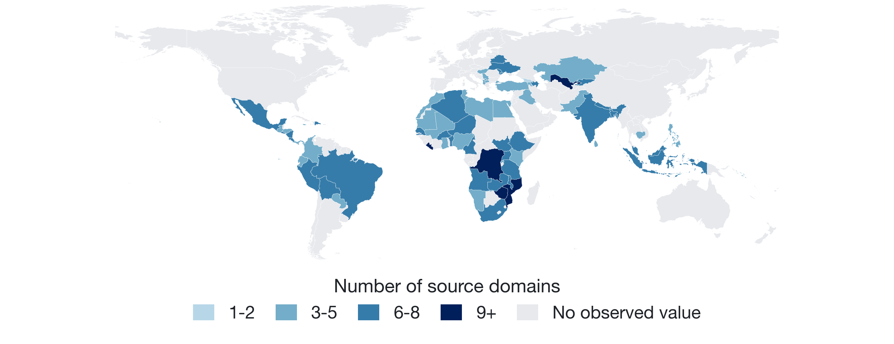
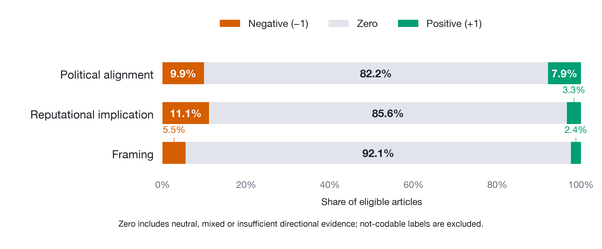
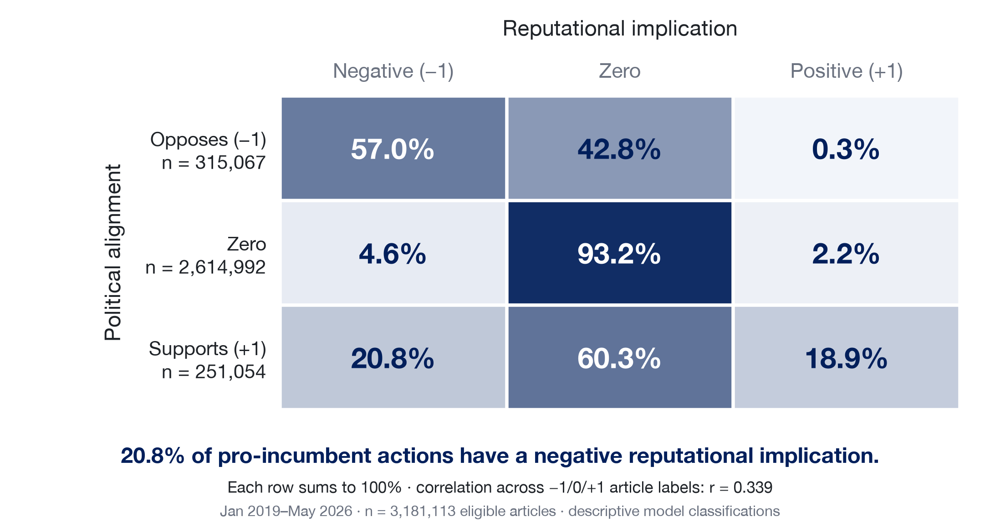
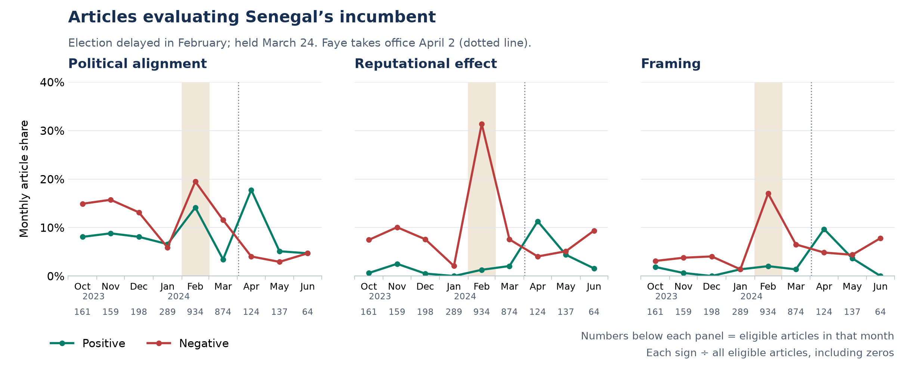
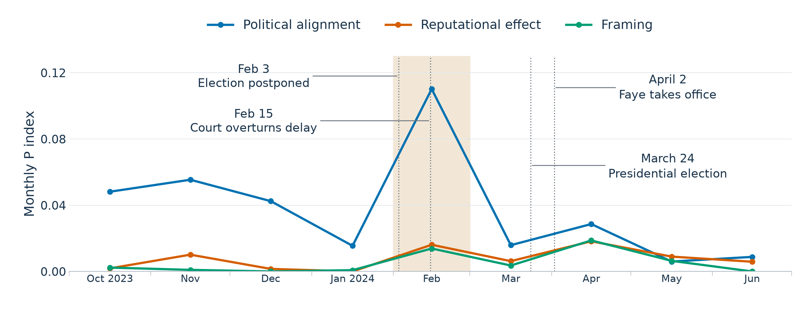
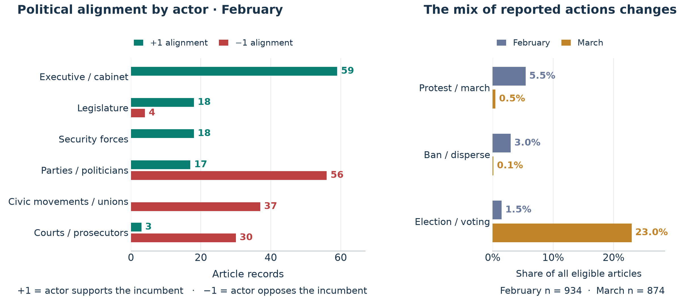
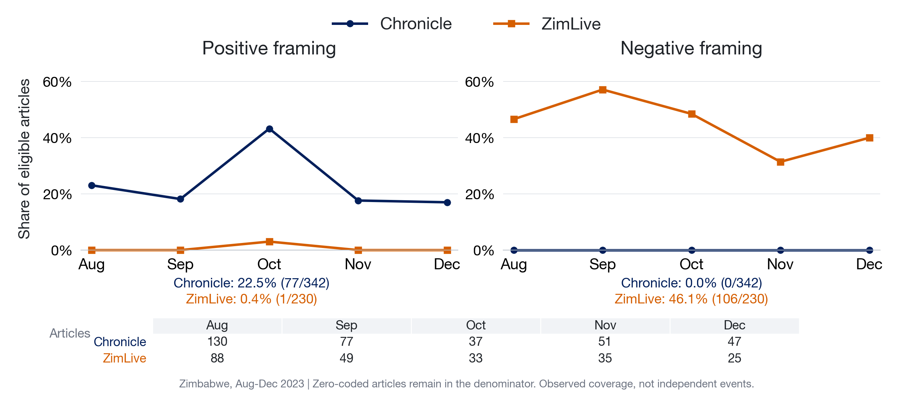
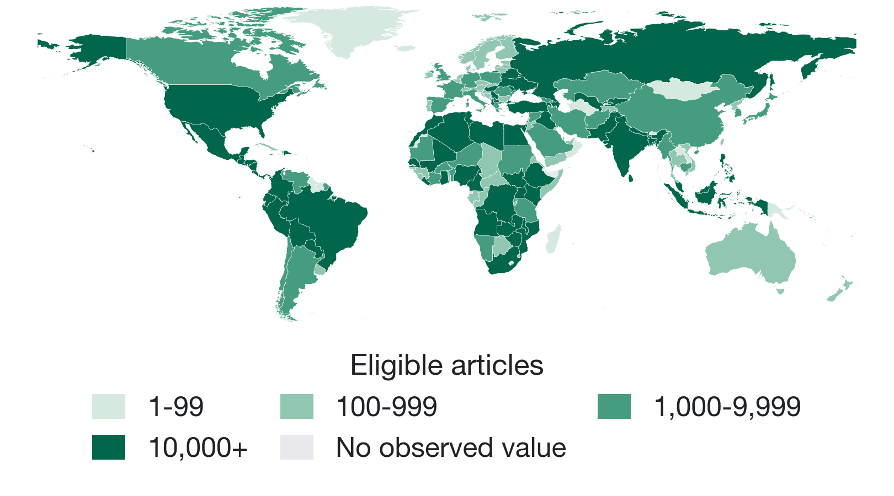
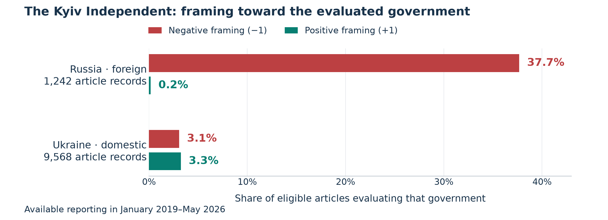
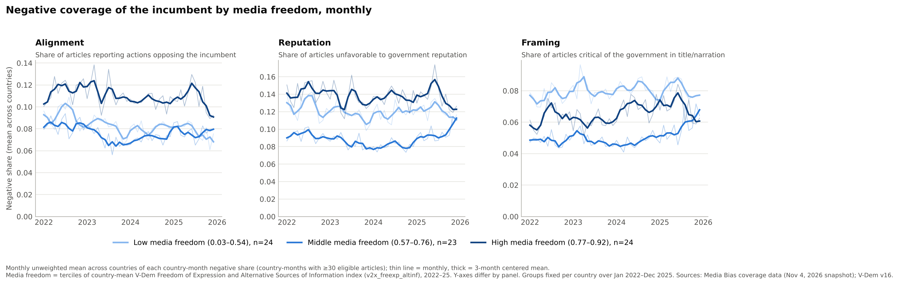

## Motivation {.smaller}

-   Polarization is understood as a common feature of politics across the world
-   Media bias is understood to be an important driver of polarization
    -   [@MartinYurukoglu2017; @kubin2021role]
-   **Big Question:** What are the consequences of media bias and political polarization for the relationship between citizens and government?
    -   Polarized voters tolerate incumbents' violations [@svolik_2019; @graham_svolik_2020]
    -   Incumbents may deepen polarization strategically [@somer_etal_2021]
-   Significant challenges measuring bias and polarization [@puglisi2015empirical; @prior2013media]
-   Can we measure media bias and polarization systematically across countries and over time to answer the big question?

::: notes
-   general dependence on policy scales derived from legislative voting behavior or public opinion data. legislative policy scales only available for a handful of countries.
-   Orhan (2022): affective polarization across 53 countries correlates with backsliding; ideological polarization does not. Cross-national, survey based.
:::


## Existing work on the US {.smaller .literature-detail}

-   **Substantive debates:**
    -   Is there a causal link between more partisan messages and changing attitudes? [@prior2013media]
    -   Is mass polarization real or confined to elites? [@fiorina_abrams_2008; @abramowitz_saunders_2008]
-   **Key findings:**
    -   Affective polarization has risen; mass ideological polarization remains contested [@iyengar_etal_2019]
    -   Media: partisan news shifts votes and can raise polarization [@MartinYurukoglu2017]; effects concentrate among viewers who are already partisan [@levendusky_2013; @prior2013media]

::: notes
-   Citation completion: add the intended Matt reference and the remaining media literature.
-   Comparability of legislative polarization measures over time requires scrutiny
-   measured as the distance between the two parties on an ideology scale estimated from roll-call votes.
-   NOMINATE, DW-NOMINATE, etc.: members who serve in many Congresses link the scale across years. Does anyone think they (and the agenda and what makes it to a floor vote) are consistent over time?
:::


## How existing work measures bias and polarization {.smaller}

-   **Measures of bias:**
    -   TV news: visibility of partisan actors [@kim2022measuring]
    -   Newspaper: similarity of language to Republican or Democrat [@gentzkow_shapiro_2010]
-   **Measures of polarization:**
    -   Legislative: distance between parties on roll-call ideal points [@poole_rosenthal_1985; @mccarty_etal_2006]
    -   Public opinion: issue-position distributions; party feeling thermometers [@lelkes2016review]
    -   Speech: partisanship of congressional speech [@gentzkow_etal_2019]

::: notes
This separates the measurement approaches already listed in the literature review from its substantive debates and findings. Citations and claims are unchanged.
:::


## Existing comparative work {.smaller}

-   **Media-system partisanship:** expert surveys on alignment and intensity of partisanship across media outlets [@popescu2011european]
-   **Party-system ideological polarization:** spread of party positions from voter or expert placements [@dalton_2008, UNC expert project]
-   **Mass affective polarization:** CSES like–dislike scores [@reiljan_2020; @wagner2021affective]; V-Dem "political polarization", near-global [@vdem]
    -   Twelve OECD countries over four decades: US shows the largest increase [@boxell_etal_2024]
-   **Relational measures:** mass partisan polarization over parties [@lauka2018mass]
-   **Common limits:**
    -   Election-year or annual frequency
    -   Survey coverage thin outside democracies
    -   Party-based scales presume stable, programmatic party systems

::: notes
-   Expert codings of polarization may be informed by the same events that define backsliding. This argues for a measure built from a different data source.
:::


## A common political reference {.smaller}

-   Bias and polarization require a political dimension and an object of comparison
    -   Party and ideological scales vary across countries and over time
-   We use the **national incumbent government** as a common reference
    -   Support and opposition can organize conflict
-   News media can reveal conflict around the incumbent at a finer time scale
-   The measurement question centers on what it means for articles to have positive or negative coverage of the incumbent

::: notes
The national incumbent is a proposed common political reference. Its relationship to societal polarization requires validation. Incumbent identity can change within a country series.
:::


## What does “negative” mean? {.sentiment-questions-slide}

```{=html}
<ol class="sentiment-questions">
  <li><span class="question-mark question-out" aria-label="Outside our measurement target">×</span><div class="sentiment-question">Did something bad happen?</div><div class="sentiment-example">“One passenger died; 100 were rescued.” </div><div class="sentiment-purpose">(General event valence — outside our measurement target.)</div></li>
  <li><span class="question-mark question-in" aria-label="A question our measures address">✓</span><div class="sentiment-question">Did someone act against the government?</div><div class="sentiment-example">“Legislators voted against the cabinet’s proposed budget.”</div><div class="sentiment-purpose">(The negativity is expressed through an action.)</div></li>
  <li><span class="question-mark question-in" aria-label="A question our measures address">✓</span><div class="sentiment-question">Does the reported conduct reflect badly on the government?</div><div class="sentiment-example">“Cabinet ministers were accused of diverting relief funds.”</div><div class="sentiment-purpose">(Negative implications for government performance or legitimacy.)</div></li>
  <li><span class="question-mark question-in" aria-label="A question our measures address">✓</span><div class="sentiment-question">Does the journalist criticize the government?</div><div class="sentiment-example">“Emergency services successfully rescue miners in government’s cynical publicity stunt.”</div><div class="sentiment-purpose">(Negative evaluation added by the author/editor.)</div></li>
</ol>
```

::: notes
All examples are illustrative. The budget vote and allegation adapt calibration examples 4–5 in ../prompts/civic_20261020_complete_v1.txt. The rescue title comes from example 6. The first example contrasts different aspects of an event; it does not imply that lives can be netted into an overall sentiment score. General event sentiment is underspecified here until the target and purpose are chosen, not inherently purposeless. An accusation remains an allegation rather than established wrongdoing. These questions precede the project's terminology. The red X marks general event valence as outside the project’s measurement target; it does not mean the question is wrong or unimportant. Green checks mark the three government-related questions the project addresses, not the truth or polarity of their answers.
:::


## Three judgments about the same government {.sentiment-definitions-slide}

```{=html}
<div class="definitions-example"><strong>Example:</strong> “Police dispersed peaceful anti-government demonstrators.”</div>
<table class="sentiment-definitions">
  <thead><tr><th>Term</th><th>What we ask</th><th>In this example</th></tr></thead>
  <tbody>
    <tr><td><strong>Political alignment</strong></td><td>Does the actor support or oppose the incumbent through this action?</td><td><strong>+1:</strong> Police restrict the government’s opponents.</td></tr>
    <tr><td><strong>Reputational effect</strong></td><td>Does the reported conduct reflect well or badly on the government?</td><td><strong>−1:</strong> Dispersing peaceful protesters reflects badly on the government.</td></tr>
    <tr><td><strong>Framing</strong></td><td>Does the narrator favor or criticize the government?</td><td><strong>0:</strong> The sentence reports what the police did.</td></tr>
  </tbody>
</table>
<div class="definitions-variation">Narrator: “Police rightly restored order by dispersing the rioters.”<br>→ <strong>Framing +1</strong></div>
```

::: notes
Definitions follow ../docs/codebook.md and ../prompts/civic_20261020_complete_v1.txt, sections 1–5. Presentation labels are Political alignment (align), Reputational effect (rep), and Framing (frame). The police case and narrator-endorsement variation are calibration examples 1–2, with supplied direct affiliation to the current national cabinet. No real event, public-opinion effect or validation result is claimed. The rescue/title case remains an optional oral contrast (calibration example 6) and appears in the fourth opening question.

Scope the substantive action before its labels: here, dispersal is the selected action, police the actor, demonstrators the entity target, and the incumbent the evaluated government. Political alignment concerns the actor's relationship to the incumbent manifested through that action, including restrictions on explicitly identified opponents; actor identity, usefulness and moral approval do not establish it. The demonstrators are the immediate entity target; their supplied opposition to the incumbent makes the police action evidence of alignment toward that government. Reputational effect uses a broad reasonable-observer standard and requires a clear government link. It can concern competence, integrity, lawful conduct, rights or responsiveness. This normative standard is neither a democracy-index input nor a claim of universal audience agreement. The prompt normally assigns rep = -1 to coercion against explicitly peaceful/lawful civic actors, rep = +1 to successful lawful action against clearly criminal/violent targets, and 0 when legitimacy, proportionality, responsibility or success is unclear (lines 92–102). Performance and legitimacy are not directly measured public beliefs.

Framing uses only the supplied title and narration. The prompt prohibits browsing, other records and outside case knowledge (line 17); its comparison holds the reported action, condition and outcome constant (line 104). This permits ordinary linguistic judgment about an added evaluation, but supplies no external neutral-news benchmark. Explicit minimization of acknowledged wrongdoing can count (line 105); omitted details, sources, gatekeeping and presumed outlet ideology cannot be inferred from one article (lines 113–115). “Rioters” is not an automatic cue: it may describe supplied violence or delegitimate critics through loaded wording. “To keep citizens safe” may be an attributed official justification rather than narrator endorsement. Require visible adoption and robust cues, especially in translation. Matched-event comparisons can study differences in emphasis or omissions separately; the majority account is not automatically a factual or neutral baseline.

The base case is +1/−1/0. The new illustrative narrator wording “Police rightly restored order by dispersing the rioters” clearly endorses the intervention through “rightly” and “restored order”; rioters alone is not an automatic positive framing cue. Peaceful status stays in the reported base case because removing it would make the negative reputation label unsupported without further context. The short slide phrase about legitimacy describes the coded implication, not measured public opinion. Detailed qualifications are retained here rather than repeated on the slide. Zero includes neutral, mixed and insufficient directional evidence; null means not codable. These are intended coding distinctions, not model accuracy results.
:::


## The classifier and processing {.classifier-slide}



::: notes
The six stages show how articles reach the analysis: collection and cleaning, translation, civic selection, GenAI coding, checks, and analytical views. The event-type and civic-relevance classifiers select the civic material. GenAI then records the actor, action, target and three political judgments. This provides the transition to the source coverage and measurement sections.
:::


## Source coverage and analytical sample {.publication-coverage-slide .source-scope-slide}

::: publication-coverage-line
**71 publication countries · 404 mapped source domains**January 2019–May 2026
:::

{fig-align="center" width="100%"}

::: publication-coverage-total
**3,181,113 eligible articles** · **26 international / mixed-country domains** also included.
:::


::: notes
The map shows publication provenance in this project's November 8 frozen analytical release: 404 source domains mapped to 71 publication countries. A further 26 international or mixed-country domains are recorded separately, giving 430 domains in total. Map color counts domains, not articles, audience exposure or political direction. Gray indicates no observed mapped source-domain value in the release.

The full January 2019–May 2026 snapshot contains 3,464,596 structurally valid records, of which 3,181,113 enter the common comparisons. An eligible record identifies a government and primary action and has numeric labels for alignment, reputation and framing. The remaining 283,483 records are excluded rather than relabeled zero. Full totals include the international/mixed sources and evaluations of both domestic and foreign governments.

This is observed processed coverage, not a representative country sample or a measure of public news exposure. Uneven archives, collection, processing completion, source mix and repeated reporting affect the sample. The separate evaluated-government map appears later.

Reproduction: analysis_snapshot.json, figures/data/06_coverage_map.csv, figures/data/06_coverage_by_year.csv and figures/data/06_split_maps_manifest.json; ../scripts/build_coverage_maps.py. Map data and analytical scope are unchanged by this layout revision.
:::


## Prompting: three judgments with a common reference {.clean-slide .prompt-clean-slide}

```{=html}
<div class="prompt-steps">
  <div><span class="step-number">1</span><h3>Which government?</h3><p>The national incumbent<br>at publication.</p></div>
  <div><span class="step-number">2</span><h3>What happened?</h3><p>The main reported action.<br>Who did what to whom?</p></div>
  <div><span class="step-number">3</span><h3>How is it evaluated?</h3><p>Political alignment<br>Reputational effect<br>Framing</p></div>
</div>
<p class="slide-takeaway">Article title and text, with country of publication, publication date and source.</p>
```

::: notes
The fields and fixed rules are defined in ../prompts/civic_20261020_complete_v1.txt and ../docs/codebook.md. Government is selected once for all three dimensions. Publication country is the default for domestic government-relevant affairs; a foreign government can be selected under the focus rule. Incumbent identity refers to the article date. The entity target need not be the evaluated government.

Input check, November 10: the current production builder sends article title and body segments, publication country, publication date and source domain. It sets incumbent_context to null; it does not map an incumbent leader, ruling party or coalition into the request. All 997 requests in a checked production packet and all 266 November 2 validation requests had null context. The prompt permits this optional field, but its synthetic examples do not establish production use. Incumbent affiliation must be established from article evidence. Source domain records provenance, not an assumed outlet ideology. See ../docs/codebook.md for the checked builder and input scope.

One prioritized action is selected from title/lead/substantive focus rather than from maximum apparent polarization. The three judgments share the selected government, but need not agree in sign. Explicit action and entity fields let us distinguish a change in reported conduct from a change in narrator evaluation. Some saved reputation evidence attaches to the broader episode; that attachment needs validation. One selected action is not a full event inventory.

The model cannot browse, import other reporting, infer outlet ideology, or treat an attributed quotation as the narrator's own position. A fixed prompt, calibration examples and required supporting spans make the intended distinctions explicit; they do not eliminate model variation or establish validity. Zero covers neutral, mixed and insufficient directional evidence. Not identified/not codable is excluded from common comparisons, not relabeled zero. Bias remains a question for comparative research, not a synonym for every positive or negative label.

The first two steps establish what the judgments refer to. This is why action selection belongs in validation, but its detailed diagnostics are in the appendix. One government and one main action are separate decisions; they are not a single unexplained restriction. The prompt's examples and evidence spans remain part of the method without becoming extra on-screen requirements for the audience.
:::


## GenAI validation (Astra-assisted) {.clean-slide .validation-main-slide}

**173 articles where human and GenAI selected the same action**

| Judgment | Review agrees | Uncertain | Change proposed |
|---|---:|---:|---:|
| Political alignment | **78%** | 16% | 6% |
| Reputational effect | **76%** | 21% | 3% |
| Framing | **90%** | 8% | 2% |

Most labels are zero. Positive and negative cases need closer checking.

::: notes
The main talk focuses on the three judgments. Every row has a denominator of 173, so the counts reconcile: alignment 135 + 28 + 10; reputation 131 + 37 + 5; framing 155 + 14 + 4. Percentages are rounded from 78.0347%, 75.7225%, and 89.5954%. “Review agrees” means the corrected November 3 Astra-assisted assessment supports Luna's recorded label, conditional on its selected action and government. “Uncertain” means ambiguous or boundary cases; “change proposed” means the saved unsupported verdict. These are dependent review outcomes, not an independent human-reference accuracy estimate or a new three-dimension coding pass.

The November 10 action review identifies 173 articles where both coders selected the same actual action, among 213 interpretable cases where both selected an action. All 173 enter this table; the old 155-case, model-only acceptance gate is retired. Four structurally invalid full outputs have readable actions and numeric political labels; their other errors remain flagged. All 173 have traceable saved label assessments. No missing review or unresolved label is treated as support. The human sheet has one legacy sentiment field, not three separate labels. Historical inputs and rules differed. The validation sample spans 2012–2025 and is not the current 2019–2026 analytical corpus.

Positive and negative cases are harder: the review supports 27/41 alignment labels, 11/31 reputation labels, and 9/21 framing labels, with uncertainty retained in each denominator. High overall support partly reflects many zeros. The appendix shows these counts, the complete three-way action comparison, and all denominator definitions. All three political labels are supported together in 108/173 articles (62.4%). These results support an inspectable coding approach and help diagnose specific disagreements. They alone do not prove representative accuracy, equivalence to human coders, or the validity of inferred public polarization.

Sources: figures/data/05_event_validation_20261110.json and ../docs/validation.md. The private source-only references were coded before the candidates were seen, followed by anonymized mapping and audits of 56 cases. Original human and producer data remain unchanged. The fresh event comparison and the saved political-label reviews are separate.
:::


## Most eligible articles have zero-coded labels {.figure-slide}

{fig-align="center" width="100%"}

::: notes
Fixed January 2019–May 2026 cohort, n = 3,181,113. Zero shares: alignment 82.2%, reputation 85.6%, framing 92.1%. Framing has 251,573 directional records. The zero class combines neutral, mixed and insufficient directional evidence. It is not an estimate of the share of unbiased articles. Strict narration rules, composition, translation and classification error may all affect the distribution. Reproduction: ../scripts/build_slide_figures.py.
:::


## Positive alignment, negative reputational effect {.figure-slide}

{fig-align="center" width="100%"}

::: notes
Fixed January 2019–May 2026 cohort. Among 251,054 positive-alignment records, 52,218 (20.8%) have negative reputational implications. Numeric article-level correlation is approximately 0.339. The table conditions reputation on alignment, with rows summing to 100%. These are model classifications, not a human-reference accuracy test or observed opinion change. Reproduction: ../scripts/build_slide_figures.py.
:::


## Senegal: coverage shifts across the election crisis {.figure-slide .senegal-series-slide}

{fig-align="center" width="100%"}

::: senegal-series-reading
February → March: articles with **positive or negative political alignment** fall from **33.6% to 15.0%**.
:::

::: notes
Plot separate positive and negative shares, not P. Shares divide each sign count by all eligible articles in the same month, including zeros. Evaluated government SEN, all publication origins. October 2023–June 2024 is displayed around the election episode; all 24 months of 2023–2024 (n = 5,504) remain in the unchanged public export. No arbitrary minimum-count mask. Small months are shown with denominators; article records are not independent events.

February n = 934: alignment 182 negative, 620 zero, 132 positive. Directional share 314/934 = 33.6%; negative 19.5%, positive 14.1%. March n = 874: 101 negative, 743 zero, 30 positive. Directional share 131/874 = 15.0%; negative 11.6%, positive 3.4%. February reputation 293 negative and 12 positive; framing 159 negative and 19 positive. A low P can hide one-sided evaluation, so the main analysis now shows the two shares directly.

Salience here means the prevalence of coded support/opposition within this selected reporting corpus. It is not general political importance, audience exposure, mobilization volume or population polarization. Changing actions, sources and coded sensitivity can all change the shares. Within-source directional alignment also falls: Xalima 65/251→23/231; Sud 71/248→23/278; L’As 24/90→8/101; France24 39/110→19/89. Between-source reweighting alone is therefore insufficient, but events/genres within sources remain uncontrolled.

UN chronology S/2024/521 para 18: Sall postponed the election February 3, parliament rescheduled February 5, Constitutional Council overturned February 15; election March 24; Faye inaugurated April 2. https://documents.un.org/doc/undoc/gen/n24/173/40/pdf/n2417340.pdf . The dotted line is positioned on April 2, just inside April, and marks the new incumbent. Monthly observations and labels sit at each calendar month's midpoint; small ticks mark month starts. Midpoint placement does not imply an observation on that day. External chronology contextualizes stored coding without recoding it. New plot: ../scripts/build_senegal_directional_shares.py; frozen source: figures/data/09_senegal_monthly_indices.csv; manifest 09_senegal_directional_shares_manifest.json. Original P assets are retained as reproducible background.
:::


## Application 1: polarization in Senegal coverage {.clean-slide .figure-slide .senegal-p-slide}

{width="100%"}

```{=html}
<div class="formula-note"><strong>P = 4 × p₊ × p₋</strong><span>p₊ and p₋ are the positive and negative article shares.</span></div>
```

::: notes
This P plot uses the same October 2023–June 2024 window and November 8 frozen sample as the preceding sign-share plot. Each line is P for one of the three judgments. Zeros remain in each sign-share denominator, with no arbitrary count threshold. Event annotations replace numeric callouts and monthly sample counts; exact values and denominators remain in the source data. The x-axis uses calendar dates: dots and month labels sit at calendar-month midpoints, while small ticks mark month starts. The dotted event lines use exact dates: February 3 and 15, March 24 and April 2. March 24 falls late within March; April 2 falls just inside April. The observations remain whole-month aggregates, not values measured on the midpoint date or a daily series.

Speaking caveat: most articles have day-level publication dates, but not all dates are reliable and observations are not guaranteed every day. The event markers supply historical context; the monthly lines cannot establish a day-by-day response. No daily completeness or date-accuracy audit is claimed here.

P = 4 × p_positive × p_negative. It rises when both directions are common. Salience, meaning the share with either positive or negative coding, is S = p_positive + p_negative. P is not salience alone: for S > 0 it equals S² times the balance of the two directions, where balance B = 4p_positive p_negative / S². A one-sided corpus can have high S and low P. The theoretical P range is 0–1; the displayed axis runs 0–0.13 to show these observed values. These are article shares, not unique events or audience exposure.

Political-alignment P falls from approximately 0.110 in February to 0.016 in March. Alignment salience falls from 33.6% to 15.0%. Reputation and framing P remain much lower because positive and negative judgments do not coexist as frequently; read their separate sign shares on the preceding slide. The next two slides examine which actors and actions help account for the changing composition of coverage.

Event chronology: Sall announced the postponement on February 3; the Constitutional Council overturned it on February 15; voting took place on March 24; Faye was inaugurated on April 2. These dates contextualize monthly measures and do not identify daily changes or causal effects. Source: UN S/2024/521, paragraph 18, https://documents.un.org/doc/undoc/gen/n24/173/40/pdf/n2417340.pdf.

This is an empirical application to polarization in news content, not evidence that citizens became less polarized. Source mix, reported events, genres, repeated reporting and model sensitivity remain possible contributors. The evaluated government is Senegal, with domestic and international source origins included. Connecting this news measure to elite or mass polarization requires independent political or attitudinal evidence. Data, formulas, exact monthly values and hashes: figures/data/14_presentation_revision_manifest.json; ../scripts/build_presentation_revision_figures.py.
:::

## Senegal: which actors and actions change? {.clean-slide .figure-slide}

{width="100%"}

::: notes
Actor rows are not exhaustive: positive counts 115/132, negative 127/182. All February labels are 132 positive, 182 negative, 620 zero. Role labels do not establish permanent allegiance: courts can constrain the incumbent, and executive/security actions can support it. The alignment is manifested through the recorded action.

The source of the lower March directional share is partly a changed action mix: protest/march 51→4; ban/disperse 28→1; voting 14→201. 168/201 voting records are zero alignment, 32 negative and 1 positive. Parties/politicians rise 164/934→357/874. This is descriptive composition, not a causal decomposition or proof that conflict disappeared. Some zero labels may be coding errors. other_act remains included 116 February, 124 March.

Among 132 positive-alignment February articles, 83 also have negative reputation (62.9%). Of those 83,47 have negative framing, 35 zero and 1 positive. This captures the conceptual distinction without measuring public reaction. Review attachment: some reputation evidence points to the wider episode rather than the selected action.

Among 182 negative-alignment February records, top specified actions include urge/call 53, condemn/accuse 24, court rule 23, protest 19, disagree/oppose 16. 26 records link security actors to civic targets; 13 ban/disperse, 8 nonlethal violence, 3 detention, 1 other, 1 security operation. 13 have positive alignment and 13 zero. Repeated reports are not 26 independent interventions. Source: figures/data/09_senegal_contributors.json; builder ../scripts/build_senegal_case.py.

The figure replaces the two tables. Left: selected actor categories and positive/negative political-alignment article counts, February 2024. Right: action shares among all eligible articles, February n = 934 and March n = 874. March voting 201/874 = 23.0%, versus 14/934 = 1.5% in February. 168 of 201 March voting records have zero political alignment. Actor categories are selected, not exhaustive; other_act stays in full denominators. Sources and figure hashes: figures/data/14_presentation_revision_manifest.json; ../scripts/build_presentation_revision_figures.py.
:::


## Senegal: connecting the labels to reported actions {.clean-slide .story-clean-slide}

```{=html}
<div class="story-cards">
 <div><h3>Sall postpones the election</h3><p>Sud · February 7</p><p class="code-line">Political alignment <b>+1</b> · Reputational effect <b>−1</b> · Framing <b>−1</b></p><p>“Dangerous Game” adds criticism to the reported executive action.</p></div>
 <div><h3>GERDDES-Africa condemns the governing majority</h3><p>Xalima · February 7</p><p class="code-line">Political alignment <b>−1</b> · Reputational effect <b>−1</b> · Framing <b>0</b></p><p>The quoted actor criticizes the government. The narrator need not.</p></div>
 <div><h3>Court overturns the postponement</h3><p>France24 · February 15</p><p class="code-line">Political alignment <b>−1</b> · Reputational effect <b>−1</b> · Framing <b>0</b></p><p>A state institution constrains the incumbent.</p></div>
 <div><h3>Voters go to the polls</h3><p>BBC · March 24</p><p class="code-line">Political alignment <b>0</b> · Reputational effect <b>0</b> · Framing <b>0</b></p><p>Voting does not automatically imply support or opposition.</p></div>
</div>
```

::: notes
These examples explain how reported actions enter the aggregate; they do not estimate label accuracy or causally explain the full monthly shift. One action per article also omits other political material. Event facts are contextualized separately from frozen input evidence. Not every voting record is neutral: the March 25 New York Times opposition-victory record is −1/−1/0, while the March 24 BBC voting record is 0/0/0.

SEN-04, Sud February 7: https://www.sudquotidien.sn/senegal-le-jeu-dangereux-de-macky-sall/ . Saved translated title includes “Dangerous Game”; selected action is presidential postponement; codes +1/−1/−1. Supplied translation 405 characters, original saved body 3515 characters. This example relies on the retained translated input and should be checked in fuller source text before strong interpretation.

SEN-03, Xalima February 7: https://www.xalimasn.com/report-de-la-presidentielle-le-gerddes-afrique-condamne-un-coup-detat-institutionnel/ . GERDDES-Africa condemns the governing majority, alleging an institutional coup; −1/−1/0. The condemnation is attributed. Supplied text 354 characters.

SEN-05, France24 February 15: https://www.france24.com/en/africa/20240215-senegal-s-constitutional-council-overturns-macky-sall-s-delay-to-feb-25-presidential-poll . Court invalidates postponement; −1/−1/0; original English 3072 characters.

SEN-06, BBC March 24: stored example/link in figures/data/09_senegal_article_examples.json; voting, 0/0/0; supplied English 421 characters. All displayed examples have exact saved-attempt membership and plan/input hashes checked against the frozen audit. Literal evidence matching is not semantic validation. Do not treat selected four examples as representative frequency estimates. Reproducible public short evidence and URLs: 09_senegal_article_examples.json.
:::


## Zimbabwe: the same incumbent, different framing {.source-series-slide .zimbabwe-series-slide}

{fig-align="center" width="100%"}

::: source-series-reading
Chronicle, September 14: **“hits the ground running”** → framing **+1**.<br> Positive and negative shares show differences that a two-sided index can conceal.
:::

::: notes
Frozen November 8 analytical sample; publication country ZWE and evaluated government ZWE. Exact domains chronicle.co.zw and zimlive.com. August–December 2023 holds the incumbent Mnangagwa reference and five overlapping months fixed. This is a selected exploratory case, not a pre-registered comparison. Pooled Chronicle n = 342:77 positive, 265 zero, 0 negative framing. ZimLive n = 230:1 positive, 123 zero, 106 negative. Positive shares 22.5% versus 0.4%; negative 0% versus 46.1%. Each denominator includes zeros and both signs; unknown/not codable stays excluded. Chronicle's positive share exceeds ZimLive's every displayed month. No volume cutoff; monthly denominators 25–130 are displayed.

The separate signs answer how much favorable versus critical narrator evaluation is observed. They do not by themselves identify media bias, audience exposure, falsehood, public opinion or societal polarization. P = 4 × p_positive × p_negative would be zero for Chronicle because no negative framing is coded, even with 22.5% positive framing. This motivates separating direction and prevalence before asking about polarization. Full-year source-month evidence is preserved in 13_zimbabwe_source_summary.json; the chart displays the common five-month period only.

The direct positive case is Chronicle September 14: https://www.chronicle.co.zw/president-mnangagwa-hits-the-ground-running-with-high-level-meeting-to-propel-zimbabwe-towards-vision-2030/ . Selected actor Mnangagwa meets ministers; alignment+1, reputation 0, framing+1. The headline phrase “hits the ground running” presents the president favorably. Original English equals supplied input 1812 characters. The page now redirects to the group's HeraldOnline site but identifies ChronicleEditor and the original September 14,2023 date; source grouping remains the frozen source domain rather than today's redirect.

Possible contributors include different events, genres, repeated stories, access, source selection, supplied text completeness and model sensitivity. The next slide offers one same-event comparison, not an adjustment of the aggregate gap. Scripts/build_zimbabwe_source_comparison.py verifies hashes and can reconcile all three frozen private caches; public aggregates and sign denominators are in 13_zimbabwe_monthly_framing.csv, 13_zimbabwe_source_summary.json and13_zimbabwe_manifest.json. Short article evidence with verified audit membership is in 13_zimbabwe_article_examples.json. No new model coding or production changes.
:::


## The same court decision, different portrayals {.clean-slide .quote-pair-slide}

**September 15, 2023: bail for opposition candidate Patrick Cheza**

```{=html}
<div class="quote-pair">
 <div><h3>Chronicle</h3><blockquote>“Sore loser…Road Rage”</blockquote><p>Framing <strong>+1</strong></p><p>Ridicules the government’s opponent.</p></div>
 <div><h3>ZimLive</h3><blockquote>“ends jail nightmare”</blockquote><p>Framing <strong>−1</strong></p><p>Emphasizes the opponent’s detention.</p></div>
</div>
<p class="slide-takeaway">Both articles: political alignment 0 · reputational effect 0</p>
```

::: notes
The two saved reports describe the same September 15 bail decision, same judge, same candidate target, same primary action tag court_rule, and evaluated government ZWE. Alignment/reputation both 0; framing +1 Chronicle, −1 ZimLive. Judge name has a spelling variation across reports; the event/court/target/date establish the match. Saved English bodies 2850 and 1633 characters equal the supplied model input; this removes translation mismatch, not all differences in completeness or genre. Both plan/source-row hashes and exact saved-attempt memberships were verified against the pinned audit. Source: figures/data/13_zimbabwe_article_examples.json. Full texts and private IDs stay outside the repository.

Do not interpret the court decision as itself pro-government. The model infers a favorable-government narrative from Chronicle's derisive portrayal of an opposition candidate; ZimLive's title emphasizes harmful detention. Those entity-to-government framing links are precisely what requires human validation. This is stronger matching than the former Kenya pair, which selected different actions, but one paired example cannot establish an outlet effect or explain the full aggregate gap. The alleged assault remains an allegation; the slide quotes only the framing cues, not a factual finding of guilt. ZimLive also reports prosecution allegations; neither account is reduced to a single quotation.

The 2023 EU Election Observation Mission report printed page 21 identifies government control of Zimpapers (51% ownership). Printed page 23 reports its newspapers gave 64% of political printspace to incumbency; 58% of that coverage was positive, none negative. Monitoring ran July 23–September 3 and used manual printspace/tone coding across ten newspapers (page 49), not our article denominator, period or construct. ZimLive was not in that monitored newspaper sample. Thus the observer evidence supplies external institutional context and a related pattern, not validation of our numeric framing rate. Zimpapers broadcast platforms differed, so ownership is not a mechanical explanation. Primary mission report preserved by Austrian Red Cross: https://www.ecoi.net/en/file/local/2101116/EU%20EOM%20ZWE%202023%20FR.pdf .

ZimLive's current About page identifies Makhwedini Media Trust, a Zimbabwe-registered company, and publication since July 2018: https://www.zimlive.com/about-us/ . The page is undated and does not verify opposition affiliation or a 2023 shareholding register. Do not call it opposition-owned from observed negative framing. Zimpapers' current charter declares editorial independence/fairness but is not a verified 2023 policy snapshot. Ownership, audience incentives, access to official sources, genre and editorial priorities remain explanations to investigate rather than causal findings. A next study would predefine matched events, code quoted sources and narration separately, inspect source originals, and compare within-outlet changes across common event categories.

Institutional context is spoken rather than another on-screen paragraph: Chronicle belongs to government-controlled Zimpapers; the EU observer report provides related evidence of favorable incumbent coverage, with different units and dates. Ownership is context, not a causal explanation of this one pair. The framing codes require human confirmation of the link between portraying the opposition and evaluating the government. Do not equate either outlet with a fixed political identity from this pair.
:::


## Application 2: foreign governments {.foreign-map-questions-slide}

::: foreign-map-subtitle
When the evaluated government differs from the country of publication
:::

::::: foreign-map-columns
::: foreign-map-figure
{width="100%"}

**211 evaluated-government country / territory codes**
:::

::: foreign-map-questions
-   Does the **same outlet** portray different governments differently?
-   Does coverage differ for **allies and rivals**?
-   Which **actors and actions** explain the differences?
:::
:::::


::: notes
The evaluated-government map counts 3,181,113 eligible articles across 211 country/territory codes. It differs in unit and scale from the publication-country map: article counts by evaluated government rather than source-domain counts by publication country. It includes domestic, foreign, and international reporting. It does not imply collection of local outlets in 211 sovereign states. Article volume is neither political polarization nor a count of unique events.

These are research questions, not estimated effects. Government selection uses the prompt's domestic default and foreign-focus rule, with one common government reference for the three judgments. The government is the incumbent at the publication date. Identifying an action's immediate target is separate from identifying the evaluated government. Keep sources, events, time, genre, and incumbent transitions explicit when comparing.

Possible designs include a source-by-evaluated-government panel over common months; comparisons of similar actions against domestic and foreign governments; and actor/action examination around diplomatic disputes or elections. Political relationships and regime context require appropriately dated external covariates and cannot be inferred from a fixed-year cloud color. Compare within-source changes and keep source composition separate. The next slide illustrates framing by one outlet toward two evaluated governments.

Map source: figures/data/06_coverage_map.csv, the same pinned November 8 release in analysis_snapshot.json, and Natural Earth v5.1.2. Reproduction and source hashes: ../scripts/build_coverage_maps.py and figures/data/06_split_maps_manifest.json.
:::


## One outlet, two governments {.clean-slide .figure-slide}

{width="100%"}

Russia receives more negative framing in this sample. The underlying events also differ.

::: notes
Source: interactions.government_outlet in hash-pinned explore-since2019.json, SHA-256 1893e92ff1c5e7c85f3966d4cce40679abc02034c8e137f1d6059a66c8eab812. Reproduced in figures/data/12_source_government_framing.csv. Exact domains: kyivindependent.com, bbc.com, reuters.com, and theguardian.com. Russia and Ukraine identify the evaluated government, not the source country.

Kyiv Independent, Russia: negative 468, zero 772, positive 2; n = 1,242; directional share 37.8422%; P approximately .00243. Ukraine: negative 294, zero 8,963, positive 311; n = 9,568; directional share 6.3232%; P approximately .00400. The negative/zero/positive counts for Russia in the other sources are BBC 167/1,788/11, Reuters 396/2,676/16, and Guardian 474/427/2. P is calculated before rounding the displayed shares.

These pooled comparisons do not hold events, articles, genre, time, translation, or political conduct constant. They motivate source–government and matched-event analysis rather than establishing double standards or a causal outlet bias. Many zeros do not establish poor sensitivity or difficulty for human readers; those questions require text review and human evaluation. P describes the coexistence of directions when read with their prevalence, not the intensity of one-sided evaluation.

This is an example for Application 2, not a second lesson on P. Separate positive and negative framing shares show direction directly. Large-scale source–government matching can identify comparisons worth testing.
:::


## Application 3: press freedom and coverage {.clean-slide .figure-slide .media-freedom-slide}

{width="100%"}

The group ordering differs across the three judgments.

**Exploratory comparison · January 2022–December 2025 · November 4 snapshot**

::: notes
The original figure was supplied by Erik Wibbels, visually inspected, and preserved without cropping or reconstructing values from pixels. Source-message and file metadata are retained privately; the public manifest provides the filename, SHA, and visible caption. V-Dem v16 variable v2x_freexp_altinf measures Freedom of Expression and Alternative Sources of Information; it is not a direct categorical regime-type measure. Fixed groups use country-mean scores for 2022–2025: low, 24 countries; middle, 23; high, 24. According to the caption, country-months require at least 30 eligible articles. Thin lines show unweighted monthly country means; thick lines show three-month centered means. The y-axes show negative shares as fractions, with different scales across panels. This applies the three measures to an institutional comparison; it does not establish a press-freedom effect.

Scope requiring confirmation with Erik: whether country means evaluated government or publication country; whether there is a domestic-source restriction; and the exact numerical inputs, membership, denominators, and treatment of missing months. No code or raw monthly table accompanied the image. The known November 4 export in the repository uses evaluated government regardless of source origin, but that does not establish which filters Erik used. Do not describe this as confirmed domestic-media evidence or evidence of regime causality. Its November 4 snapshot differs from the November 8 snapshot used for the main empirical figures. In the visible figure, the high-freedom group generally has more negative alignment and reputation coverage, while the group ordering for framing differs. Avoid precise numerical claims that have not been reproduced. This is exploratory evidence, not independently reproduced validation. Manifest: figures/data/15_erik_media_freedom_manifest.json.
:::


## Discussion {.clean-slide}

- When do differences in coverage count as media bias?
- How does news coverage relate to political polarization?
- Which comparisons should we test next?

::: notes
The questions follow the three applications. Invite discussion of a comparison benchmark for bias, independent evidence on polarization, and validation or matched-event studies. Detailed measurement and action-selection diagnostics are available in the appendix.
:::


## Appendix: choosing the same reported action {.clean-slide .backup}

**Three-way comparison · the same 251 reviewable articles**

| Comparison | Same action | Agreement |
|---|---:|---:|
| Human–Luna | 179 / 251 | **71.3%** |
| Human–review reference | 184 / 251 | **73.3%** |
| Luna–review reference | 221 / 251 | **88.0%** |

First establish **what was selected**. Then compare its political labels.

::: notes
Why this appendix matters: two coders may select different actions in one article. Their alignment or reputation labels can then differ for substantive reasons rather than inconsistent application of definitions. Event identity is not exact phrase equality, and an actor-role extraction defect can coexist with the same selected occurrence. Conversely, allegations versus alleged conduct, proposals versus implementation, and opposing participants' actions remain distinct.

All 266 original historical articles received new source-only references under the fixed current prompt. Two Astra workers split the corpus, with 133 articles each; this is not two independent reviews per article. References were frozen before anonymized A/B choices were mapped. A separate audit, with coder names hidden, examined 56 cases: a fixed hash sample of 20, all references without a single selected action, and cases with concerns or borderline identities. Four references changed. Original source-only output, mappings, audit decisions, and version hashes are preserved privately. The final reference is model-assisted and partially adjudicated after viewing anonymized choices; it is not human ground truth. No human has independently confirmed all new references.

The common 251-case comparison includes both coders' interpretable choices and a unique reference. The other 15 cases comprise 12 with insufficient text, one unresolved reference, and two ambiguous selected-action anchors. Neither correctness nor a Luna-only acceptance flag determines membership. Explicit no-action is a valid choice; missing or ambiguous identity is not NONE. All four structural model failures have readable actions and remain in event-only diagnostics. This symmetric construction supersedes the old 187-case subset and its 82.9/90.9/91.4 rates, which are preserved as historical documentation.

Historical inputs and rules differed: seven text views changed, and 193/266 articles date from 2012–2013. This does not establish Luna's superiority or population accuracy. Excluding changed views gives human–Luna 175/245, human–reference 180/245, and Luna–reference 215/245. Restricting to valid outputs gives 175/247, 180/247, and 217/247, respectively. The initial blind-pass rates on 251 cases were 180/251, 186/251, and 220/251. Assigning either possible anchor to each of the two ambiguous cases gives a common denominator of 253: human–Luna 179–181 matches, human–reference 184–186, and Luna–reference 223. Uncertainty remains visible. Full metrics and provenance: figures/data/05_event_validation_20261110.json and ../docs/validation.md.
:::


## Appendix: where action choices differ {.clean-slide .backup}

| On the common 251 articles | Articles |
|---|---:|
| All three select the same action | **172** |
| Only Luna matches the review reference | **49** |
| Only the human matches the review reference | **12** |
| Human and Luna agree; reference differs | **7** |
| All three select different actions | **11** |

Among both choosing an action: **173 / 213 agree (81.2%)**.<br>
Including explicit no-action choices: **184 / 264 agree (69.7%)**.

::: notes
The five groups partition 251 cases and reproduce all three pairwise rates: human–Luna 172 + 7 = 179; human–reference 172 + 12 = 184; Luna–reference 172 + 49 = 221. Shared choices that differ from the reference remain included. The full 264 interpretable human–Luna pairs include 173 shared actual actions, 40 different actual actions, 11 shared NONE choices, and 40 one-sided action/NONE choices. Two ambiguous anchors remain outside this observed-pair comparison; their alternative assignments are documented. Structural-output and changed-text filters are separate diagnostics. All four structural failures are retained here because their actions are interpretable.

The historical review's 121 Luna-preferred and 44 human-preferred cases mix selection and extraction quality and are no longer the main action result; see the historical validation archive. Agreement on action identity can coexist with a preference for a more complete extraction. The new three-way comparison measures identity only.
:::


## Appendix: other fields after choosing the same action {.clean-slide .backup}

**173 shared actions · compare each field where both values are available**

| Recorded field | Human–Luna matches |
|---|---:|
| Main action category | 109 / 173 · **63.0%** |
| All action categories | 100 / 173 · **57.8%** |
| Actor category | 108 / 157 · **68.8%** |
| Exact actor wording | 48 / 154 · **31.2%** |
| Prior action triggering this action | 9 / 20 · **45.0%** |
| Evaluated government | 5 / 13 · **38.5%** |

::: notes
Main action category means the first tag; all action categories compares the exact tag set, not string ordering. Actor category extracts the existing A–W code. Exact actor wording means literal equality, not semantic entity accuracy. Case and spacing normalization raises the match rate to 57/154 (37.0%). Short aliases can identify the same entity.

Missing or uncodable values are not credited as matches and are excluded from each field's denominator. Among 173 shared actions, 157 human government fields are missing, three are multiple or uninterpretable, five match, and eight differ; only 13 are comparable. That small, selective comparison cannot validate government selection overall. The reaction comparison has only 20 paired substantive values. The new cohort includes four structurally invalid full records with interpretable actions; their status is preserved in the aggregates.

No complete independent third set of these fields exists, so a three-way field table cannot be supplied. Source-based review and historical tag assessments answer different questions.
:::


## Appendix: checking positive and negative labels {.clean-slide .backup}

| Review agrees with GenAI | All labels | Only +1 / −1 labels |
|---|---:|---:|
| Political alignment | 135 / 173 · **78.0%** | 27 / 41 · **65.9%** |
| Reputational effect | 131 / 173 · **75.7%** | 11 / 31 · **35.5%** |
| Framing | 155 / 173 · **89.6%** | 9 / 21 · **42.9%** |

Zeros raise overall agreement. Ambiguous cases remain in the denominators.

::: notes
These are saved November 3 dependent evidence-review outcomes, reconditioned on 173 shared actual actions from the November 10 review; they are not fresh independent labels. Among directional labels, alignment has 27 supported, five open, and nine proposed changes; reputation has 11/17/3, and framing 9/8/4. The all-label counts on the main slide include 132 alignment zeros, 142 reputation zeros, and 152 framing zeros. All three labels are supported in 108/173 articles (62.4%). The human exercise has one legacy sentiment field; it cannot supply separate human alignment, reputation, and framing scores. The review's proposals often copy accepted Luna values, so agreement with those proposals must not be presented as independent accuracy.

Optional example for questions: Reuters, Baku, October 12, 2013, describing police beating or detaining opposition protesters. The human's single sentiment is −1. Luna records (+1, 0, 0); the earlier review gives (+1, −1, open). This illustrates the distinction between actor alignment, substantive government implication, and narrator framing, not a verified production correction. Historical country references are sparse. All new source/action decisions are private; no production records or prompts changed. These conditional diagnostics identify where human validation is needed. They do not justify a broad claim of 80–90% accuracy.
:::


## Appendix: what stronger research claims require {.validation-slide .backup}

| What we want to establish | What we need next |
|------------------------------------|------------------------------------|
| **The codes capture the intended distinctions** | Independent human coding of all three dimensions, including enough positive and negative cases and checks against original-language text. |
| **Outlets systematically portray governments differently** | Repeated comparisons of the same events. Separate action selection, quoted voices and narrator wording. |
| **The media environment relates to political polarization** | Compare news measures with independent evidence on political actors or citizens. Keep coverage direction, its prevalence and disagreement separate. |

::: sample
The current findings identify comparisons worth testing. Source differences alone do not establish bias, its causes or its effects on citizens.
:::

::: notes
The progression is measurement validity, comparative coverage, then the link to polarization. Negative coverage may reflect opposition conduct, damaging government behavior, narrator judgment, or selection among events. A claim about media bias needs an explicit benchmark and comparison, rather than equating any negative label with bias. A news-based measure of coexisting positive/negative coverage is also not automatically an estimate of societal polarization. Audience exposure and public attitudes are separate units requiring independent evidence.

Representative human-reference accuracy of the three current labels remains unmeasured. The historical human field cannot serve as three independent labels. Dependent AI review helps select disagreements for adjudication but does not establish performance. Review government/action/entity extraction, narrator attribution and translation, with explicit sampling of minority directional labels. Study sensitivity to source mix, repeated reporting, prompt version, zero codes and the action-based eligibility rule. Preserve unknown/not codable separately. Documentation: ../docs/validation.md and ../docs/codebook.md.
:::


## References {.smaller .backup .scrollable}

::: {#refs}
:::
