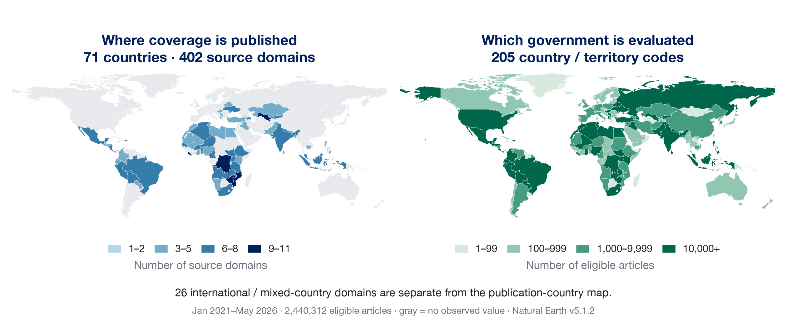
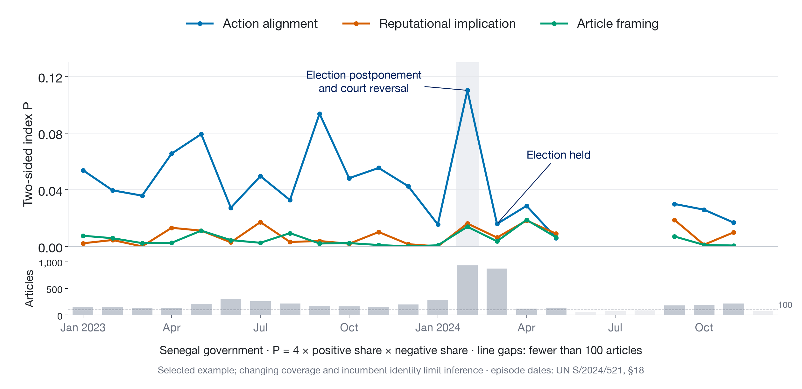

## The Puzzle {.smaller}

- Polarization is understood as a common feature of politics across the world
- Big Question: Is it a cause or a consequence of democratic backsliding?
  * Theory runs both ways: polarized voters tolerate incumbents' violations [@svolik_2019; @graham_svolik_2020]; incumbents deepen polarization strategically [@mccoy_etal_2018]
- Most research is on the US (+ a few others)
- Cross-national evidence linking polarization to backsliding is largely correlational and slow-moving [cites]
- Can we measure polarization systematically across countries and over time to answer the big question? 

::: notes
- general dependence on policy scales derived from legislative voting behavior or public opinion data. legislative policy scales only available for a handful of countries.
- Orhan (2022): affective polarization across 53 countries correlates with backsliding; ideological polarization does not. Cross-national, survey based.
:::


## Existing work on the US {.smaller .literature-detail}

- **Substantive debate:** is mass polarization real or confined to elites? [@fiorina_abrams_2008; @abramowitz_saunders_2008]. The field has since shifted from ideology to affect [@iyengar_etal_2019]
- **Measures of polarization:**
  * Legislative: distance between parties on roll-call ideal points [@poole_rosenthal_1985; @mccarty_etal_2006]
  * Public opinion: issue-position distributions; party feeling thermometers [cites]
  * Speech: partisanship of congressional speech [@gentzkow_etal_2019]
  * Media:....Gentzow, Shapiro, Taddy
- **Key findings:**
  * Roll-call polarization has risen steadily since the 1970s [@mccarty_etal_2006]
  * Affective polarization has risen; mass ideological polarization remains contested [@iyengar_etal_2019]
  * Media: partisan news shifts votes and can raise polarization [@martin_yurukoglu_2017]; effects concentrate among viewers who are already partisan [@levendusky_2013; @prior_2013]

::: notes
- Citation completion: add the intended Matt reference and the remaining media literature.
- Measures of legislative polarization over time are crap
- measured as the distance between the two parties on an ideology scale estimated from roll-call votes.
- NOMINATE, DW-NOMINATE, etc.: members who serve in many Congresses link the scale across years. Does anyone think they (and the agenda and what makes it to a floor vote) are consistent over time?
:::


## Existing comparative work {.smaller}

- **Party-system ideological polarization:** spread of party positions from voter or expert placements [@dalton_2008, UNC expert project]
- **Mass affective polarization:** CSES like–dislike scores [@reiljan_2020; @wagner_2021]; V-Dem "political polarization", near-global [@vdem]
  * Twelve OECD countries over four decades: US shows the largest increase [@boxell_etal_2024]
- **Relational measures:** mass partisan polarization over parties [cite]
- **Common limits:**
  * Election-year or annual frequency
  * Survey coverage thin outside democracies
  * Party-based scales presume stable, programmatic party systems

::: notes
- Duh: expert codings of polarization may be informed by the same events that define backsliding. This argues for a measure built from a different data source.
:::


## A common political reference {.smaller}

- Polarization requires a political dimension and an object of comparison
- Party and ideological scales vary across countries and over time
- We use the **national incumbent government** as a common reference
  * Support and opposition can organize conflict in fluid party systems and autocracies
  * This connects to accounts of “pernicious” polarization [@mccoy_etal_2018]
- News can reveal conflict around the incumbent at a finer time scale
- The measurement question is what an article's positive or negative content refers to

::: notes
Suggested time: 2–3 minutes, as the handoff from the literature section.

This retains the common-incumbent proposal from Erik's analytical-challenges slide. Treat the link between conflict around the incumbent and polarization as a proposition to test, not as a universal equivalence. An incumbent reference is comparable as a role but the person or coalition occupying it can change.

Suggested handoff: “If the incumbent is our reference point, we still need to decide what a positive or negative article means.” The next speaker can explain why the project keeps three separate fields.
:::


## Sentiment about what? {.definition-slide}

A product review evaluates a product or feature. Political reporting can evaluate different objects within the same article.

| Field | Political question |
|---|---|
| **Action alignment** | Does the reported action support or oppose the incumbent? |
| **Reputational implication** | What does the conduct imply about the government's performance or legitimacy? |
| **Evaluative framing** | Does the narration add approval or criticism of the government? |

::: {.definition-bottom}
Word counts, dictionaries and embeddings are methods. The evaluation target gives a score its meaning.
:::

::: notes
Suggested time: 3 minutes. Begin your section with the conceptual disagreement.

“We were using the same word, sentiment, for different political questions. The solution was to record those questions separately.” Explain the product-review analogy briefly, then use the three rows to define the fields once.

Word counts, sentiment dictionaries and embeddings are ways to represent text or estimate a label. They do not define what the label means. Traditional sentiment analysis includes document, sentence, target and aspect-level approaches. Product reviews ask for an evaluation of a product or a feature, not merely a list of descriptive words. Spam detection is a different classification task: whether a message belongs to an unwanted-message class.

We should not say that sentiment research rarely defines its purpose. The narrower point is that a generic positive/negative score can fail to match the political question we intend. We spent a long time discussing "sentiment" while asking different questions. The three fields make those differences explicit.

Background for this explanation, not a replacement for the literature section: Bing Liu, Sentiment Analysis and Opinion Mining, https://www.cs.uic.edu/~liub/FBS/SentimentAnalysis-and-OpinionMining.html ; Pang, Lee and Vaithyanathan (2002), https://aclanthology.org/W02-1011/ ; Sobhani, Mohammad and Kiritchenko (2016), https://aclanthology.org/S16-2021/ .
:::


## One event, different judgments {.worked-example-slide}

```{=html}
<p class="event-quote">“Police dispersed peaceful anti-government demonstrators outside parliament.”</p>
<div class="event-entities"><span><strong>Actor</strong> Police</span><span><strong>Entity target</strong> Demonstrators</span><span><strong>Government evaluated</strong> National incumbent</span></div>
<table class="event-judgments">
<thead><tr><th>Field</th><th>Descriptive account</th><th>Narrator adds an endorsement*</th></tr></thead>
<tbody>
<tr><td><strong>Alignment</strong></td><td><b class="score-positive">+1</b> Restricts explicit opponents</td><td><b class="score-positive">+1</b> Same action</td></tr>
<tr><td><strong>Reputation</strong></td><td><b class="score-negative">−1</b> Coercion against peaceful protesters</td><td><b class="score-negative">−1</b> Same implication</td></tr>
<tr><td><strong>Framing</strong></td><td><b class="score-zero">0</b> No added evaluation</td><td><b class="score-positive">+1</b> Narration legitimates the action</td></tr>
</tbody></table>
<p class="endorsement-text">*“…in a <strong>necessary operation that restored order.</strong>”</p>
<p class="example-assumption">Synthetic example. Direct cabinet affiliation is supplied. Institutional role alone does not establish alignment.</p>
```

::: notes
Suggested time: 4 minutes. Use this single example to explain the entities and the three codes. Do not repeat the definitions as another three-part introduction.

First identify who acted, what they did, the entity acted upon, and the government being evaluated. The demonstrators are the entity target while the national incumbent is the government reference. “Police forcibly dispersed peaceful anti-government demonstrators” is a natural spoken description of this example.

The national executive and cabinet are the reference, including a ruling party or coalition when the supplied record establishes the affiliation. Courts, legislatures, local officials and security forces are not automatically incumbent members. Their institutional role and the political direction of their action are separate judgments.

"Primary" does not mean the first event chronologically or whichever event produces the strongest sentiment. The selection hierarchy is a substantive headline action, then the lead, then the earliest repeatedly developed action, with centrality to government breaking a tie. Substantive statements such as accusations and endorsements count as actions. Generic "said" or "reported" does not by itself.

An entity target must be explicit. A policy or budget is not an entity. One article yields one prioritized action, not an exhaustive event inventory or a complete actor network.

The stored action span in calibration example 1 is "dispersed peaceful anti-government demonstrators," copied exactly from the supplied text. The entity target and the government evaluated are different fields.

The exact synthetic title is "Police disperse peaceful anti-government march." The text is "Police dispersed peaceful anti-government demonstrators outside parliament." The prompt supplies direct cabinet affiliation. "Forcibly disperse peaceful demonstrators" is a useful spoken description of the coercion example.

Alignment is action-grounded, not a claim of complete objectivity or of the actor's private political beliefs. A positive value describes political direction, not moral approval. Identity alone never establishes the code.

Reputation applies the project's reasonable-observer standard to performance and legitimacy. It requires a link to the government and sufficiently clear substantive implications. Different audiences may judge the event differently. The label does not establish that domestic or international opinion actually changed, and it does not use later events to infer an effect.

Framing measures an observable evaluative cue. A bad event can receive frame = 0. These are different questions, rather than a universal ranking from objective to subjective.

The phrase is from a synthetic example. We keep the peaceful status, selected action and government affiliation constant. The narrator adds an endorsement, so only framing changes.

We measure expressed presentation cues rather than the author's private intention or an outlet's permanent political position. Translation can erase or introduce subtle connotations. The conservative prompt generally uses zero when a cue may be a translation artifact.

An article with frame = 0 can still reflect selective reporting. Repeated article comparisons can describe action choice, hostile/favorable coverage shares and narrated evaluation. Attributing those patterns to bias requires a comparison baseline, stable source coverage and ideally matched events. Different outlets may simply report different events. The present aggregates do not match events across outlets.
:::


## The current analysis sample {.corpus-slide}

::: {.corpus-period}
January 2021–May 2026
:::

```{=html}
<div class="corpus-counts"><div><strong>2,654,346</strong><span>Structurally valid records</span></div><div><strong>2,440,312</strong><span>Eligible for joint comparisons</span></div></div>
```

- **One article, one prioritized action** with a government reference and actor/target fields
- Repeated reporting of the same event creates multiple observations
- Collection, civic selection, translation and processing completion shape this sample
- Coverage is expanding. Each release fixes the period, counts and input versions together

::: {.sample}
November 4, 2026 snapshot. All three labels are codable in the common sample. The remaining 214,034 valid records are excluded from these joint comparisons.
:::

::: notes
Suggested time: 2 minutes. State the observation unit, period and snapshot together. This is a sample of coded reporting, not a complete census of political events.

The January 2021–May 2026 view contains 2,654,346 structurally valid complete-prompt records and 2,440,312 comparison-eligible records. The difference is 214,034. Eligibility requires an identified evaluated government and primary action plus numeric labels on all three measures. Excluded valid records are not recoded as zero.

The hash-pinned November 4 snapshot already contains the 2021 extension. Later processing totals are different populations and are not substituted into these figures. The live Space can accumulate more records while this deck remains reproducible. Update the input manifest, all plotted data, counts and notes as a single release.

The historical civic extraction inventory has 7,373,816 unique eligible IDs, while the production target spans January 2012–June 2026. Neither number is the completed sample on this slide. Broad MLP collection totals and collection-paper discussion belong with the team's introduction. Source: ../data/analysis_snapshot.json, optional_since_2021, and ../docs/data-card.md.
:::


## Source countries and evaluated governments {.figure-slide}

{fig-align="center" width="100%"}

::: notes
Suggested time: 1.5 minutes. Source: frozen November 4 monthly aggregates, filtered to January 2021–May 2026. Figure and plotted data are reproduced by ../scripts/build_slide_figures.py.

A publication-country code describes source provenance. A government code identifies the national incumbent evaluated in a particular article. These are not interchangeable. Domestic government is the default, but the prompt allows a foreign government when its stated foreign-government conditions hold. International and regional publications can use ALL for provenance, but the evaluated government must be a specific code.

This explains why governments such as Afghanistan, Andorra and the UAE can appear in the monthly CSV even where MLP does not scrape domestic outlets. Counts are uneven and very small groups do not support stable national estimates. The map describes the analyzed sample, not the full collection or press freedom.
:::


## The classifier {.classifier-slide}



::: notes
Suggested time: 4 minutes. Follow the six stages once, then explain the design choices in the lower half. This is where you discuss the practical compromise behind the richer record.

The two encoder classifiers supply civic-event type and civic relevance. The active selection rule requires affirmative civic relevance and a valid primary civic event. It excludes disaster and missing/invalid primary event codes. A missing secondary event is allowed, while an invalid secondary event is excluded. The models are two classifiers, not a claim about a dual-encoder architecture.

Before GenAI, the pipeline uses supplied translated titles and the full supplied English body, including English originals in the same fields. Input checks reject empty/invalid bodies and wholly non-English input. There is no sentence-count minimum. Usable English does not establish faithful translation.

One article becomes one independent request inside an asynchronous batch. Every request carries the complete prompt, input structure and recorded settings. The prompt selects government and action first, then applies separate label rules. Exact evidence and boundary examples make choices inspectable. Allegations remain allegations. Actor and source identities cannot substitute for textual evidence. The model works from supplied material without browsing or outside case knowledge.

Fixed prompts and settings constrain variation but do not guarantee deterministic results or remove bias. Prompt caching is a cost/reuse mechanism, not a semantic consistency guarantee. Older prompt outputs remain separate.

Parsing checks returned IDs, field types, allowed values and exact copied spans. Independent readback verifies storage. These are mechanical checks, not political interpretation accuracy. The common analytical cohort keeps zeros but excludes nulls and unidentified government/action records. Residual actions and unknown actors stay outside named-contributor comparisons.

Public sources: ../docs/codebook.md, ../prompts/version.json, ../prompts/civic_20261020_complete_v1.txt and ../docs/validation.md.
:::


## Monthly shares, direction and balance {.coverage-examples-slide}

```{=html}
<p class="measure-unit">For each government and month, calculate separately for each field.</p>
<div class="measure-formulas"><div><strong>Net direction</strong><span>N = p<sup>+</sup> − p<sup>−</sup></span></div><div><strong>Proposed two-sided index</strong><span>P = 4p<sup>+</sup>p<sup>−</sup></span></div></div>
<div class="distribution-example" role="table" aria-label="Three synthetic months with shares, net direction and proposed two-sided index">
  <div class="distribution-head" role="row"><span role="columnheader">Synthetic month</span><span role="columnheader">Share of articles</span><span class="number-head" role="columnheader">Net</span><span class="number-head" role="columnheader">P</span></div>
  <div class="distribution-row" role="row">
    <span class="distribution-name" role="rowheader">All zero-coded</span>
    <div class="distribution-bar" role="cell" aria-label="100 percent zero"><span class="zero-share" style="width:100%">100%</span></div>
    <span class="distribution-number" role="cell">0</span><span class="distribution-number" role="cell">0</span>
  </div>
  <div class="distribution-row" role="row">
    <span class="distribution-name" role="rowheader">Mostly positive</span>
    <div class="distribution-bar" role="cell" aria-label="40 percent zero, 60 percent positive"><span class="zero-share" style="width:40%">40%</span><span class="positive-share" style="width:60%">60%</span></div>
    <span class="distribution-number" role="cell">.60</span><span class="distribution-number" role="cell">0</span>
  </div>
  <div class="distribution-row" role="row">
    <span class="distribution-name" role="rowheader">Both directions</span>
    <div class="distribution-bar" role="cell" aria-label="45 percent negative, 10 percent zero, 45 percent positive"><span class="negative-share" style="width:45%">45%</span><span class="zero-share" style="width:10%">10%</span><span class="positive-share" style="width:45%">45%</span></div>
    <span class="distribution-number" role="cell">0</span><span class="distribution-number" role="cell">.81</span>
  </div>
</div>
<div class="distribution-legend"><span><i class="negative-share"></i>Negative</span><span><i class="zero-share"></i>Zero</span><span><i class="positive-share"></i>Positive</span></div>

```

::: {.sample}
Synthetic months. Shares use the common eligible denominator. Zero stays in the sample, null does not. P describes coded coverage, and its link to societal polarization needs validation.
:::

::: notes
Suggested time: 3 minutes. Explain the shares before introducing the two summaries. All the formula illustrations appear here, once.

The formula responds both to the prevalence of directional reporting and to its balance. For example, a negative-only month has P = 0 even if every report is negative. Thus P is not overall hostility or a measure of every possible definition of polarization. When both directions are present, a higher nonzero share raises P holding directional balance constant. At a fixed nonzero share, P rises as the two sides approach equality.

Erik's comparison with polarization theory remains an open task. Distribution-based indices motivate the question [@esteban_ray_1994], but this proposed formula is not the full Esteban–Ray measure for a three-category distribution. Its relationship to societal polarization requires validation. The observed zero class is heterogeneous, and treating it as an intermediate position is itself an assumption.

"Net alignment" and "net reputation" in the point clouds mean the same positive-minus-negative calculation for the relevant field. A net near zero can arise through very different distributions.

These are arithmetic illustrations, not observed countries. The last row has 4 × .45 × .45 = .81. The first row should not be called "consensus": zero-coded reporting can include mixed or insufficient evidence. The second row shows why a strong one-sided signal can have P = 0. The formula therefore complements rather than replaces shares and net direction.

The equivalent expression is P = (1 − p0)^2 − N^2. This makes the role of nonzero prevalence explicit. Always report the three shares and article count alongside either score.
:::


## Most eligible articles have zero-coded labels {.figure-slide}

{fig-align="center" width="100%"}

::: notes
Suggested time: 1.5 minutes. Source: fixed November 4 cohort, January 2021–May 2026, n = 2,440,312 eligible joint comparisons. Reproduction: ../scripts/build_slide_figures.py.

Zero shares are 82.4% for alignment, 85.9% for reputation and 92.2% for framing. The framing rule requires explicit evaluation beyond the event, so its directional share can be much smaller. We cannot infer that 92.2% of articles are unbiased. The conservative rule, translation, article composition and model errors may each contribute. The chart describes model labels on the common sample rather than validated population prevalences.
:::


## Supporting the incumbent can still reflect badly on it {.figure-slide}

{fig-align="center" width="100%"}

::: notes
Suggested time: 2 minutes. Same fixed cohort and common denominator as the preceding slide. Reproduction: ../scripts/build_slide_figures.py.

The numeric article-level correlation between alignment and reputation is about .338. Among 190,409 pro-incumbent actions, 38,322 or 20.1% have negative reputational implications. This illustrates why we retain both fields. It does not establish independence, causal effects or human-reference accuracy. Correlation depends on the coding and the large zero category. The joint table is more informative than the coefficient alone.

Country-level averages can have a different correlation than individual articles. Neither level should be substituted for the other. Actor/action composition and source mix are natural next comparisons.
:::


## Monthly comparisons: Senegal {.figure-slide}

{fig-align="center" width="100%"}

::: notes
Suggested time: 2.5 minutes. Same fixed November 4 release. Figure compares the proposed P for all three fields using the same eligible government-month records. It includes article volume, and low-count periods must be treated cautiously. Senegal is an illustrative case, not selected as a representative estimate or a test of causality.

In February 2024, n = 934 and P is approximately .110 for alignment, .016 for reputation and .014 for framing. Negative shares are 19.5%, 31.4% and 17.0%, respectively. Reputational negativity is much larger than its two-sided index because favorable reputation coding is rare. This answers why "more negative" and "more polarized" need not move together.

The period includes the dispute over delaying Senegal's presidential election. The dashboard's sourced story provides context, but those events are not matched to individual records in this aggregate figure. Changes may reflect event mix, outlet coverage, processing coverage and coding, alongside real political developments. Use the plotted source-data file to examine the shares, not only P.
:::


## What needs validation {.validation-slide}

| Question | Required evidence or comparison |
|---|---|
| Did we select the right government, action and entity roles? | Stratified human review of the extracted record |
| Do the labels mean the same thing across contexts? | Separate review of alignment, reputation and framing across countries and languages |
| Does translation preserve attribution and evaluation? | Compare source text with the supplied English text |
| What does the action-based design miss? | Review conditions and indirect criticism without a codable action |
| How stable are the findings? | Sensitivity to source mix, repeated reporting, prompt version and zero codes |

::: {.sample}
Representative human-reference accuracy remains unmeasured. Verified storage and valid JSON do not establish semantic validity.
:::

::: notes
Suggested time: 2 minutes. End your section by separating the validation tasks from the research agenda.

The richer record makes disagreements diagnosable: reviewers can distinguish a wrong government, wrong action, wrong actor role and disagreement over one label. Human agreement should be measured on the current three definitions. An old generic sentiment label cannot serve as three observed reference labels, and dependent AI adjudication is not independent human ground truth.

The action-based design may miss rising inflation or another politically important condition without a codable actor/action relationship. Indirect criticism may be especially important under repression. Unknown and uncodable records need their own accounting rather than being treated as substantive categories.

Your handoff: “We can now ask what each field captures reliably, and when these coverage patterns tell us something about politics beyond the reporting.” Source: ../docs/validation.md and ../docs/codebook.md.
:::


## Research agenda {.agenda-slide}

| Substantive question | Comparison needed |
|---|---|
| Which actors and actions account for changes in the indices? | Contributions within a government and month, with article counts |
| Do outlets present the same events differently? | Matched events, source panels and explicit evaluation cues |
| How do patterns differ across countries and regions? | Comparable periods, coverage composition and incumbent transitions |
| Does divided coverage precede or follow democratic backsliding? | External polarization measures and a design that handles monthly reporting versus annual indicators |

::: notes
Suggested time: 5–7 minutes, led by the theory/comparative speakers as a proposal rather than an assigned role.

Return to the opening question. The three fields can lead to different hypotheses. An aligned action can damage reputation, and evaluative framing may reflect a separate choice about narration. Country and region contrasts require comparable sources and periods. Government turnover changes the reference even if the country label stays fixed.

Lead/lag correlations alone do not identify whether polarization causes democratic change. Event selection, repeated reporting, changing outlets and publication intensity can move the series. Stable source panels, matched events, external public-opinion or expert measures, and explicit temporal assumptions should guide a stronger design.

The current aggregates do not match the same events across outlets. Actor/action contributions are descriptive decompositions, not causal effects. Keep model-coded reputation separate from a measured reputation change in domestic or international audiences.
:::


## Discussion

- Which patterns in reported action and evaluation should count as evidence of polarization?
- What comparisons would distinguish political change from changing coverage?

::: notes
Suggested time: remaining discussion time, approximately 10–12 minutes in a one-hour session.

Invite responses on the concept, the validity of the three labels, and the comparisons needed to connect media coverage to societal polarization. This replaces a second summary of the definitions.
:::


## References {.smaller .backup .scrollable}

::: {#refs}
:::
